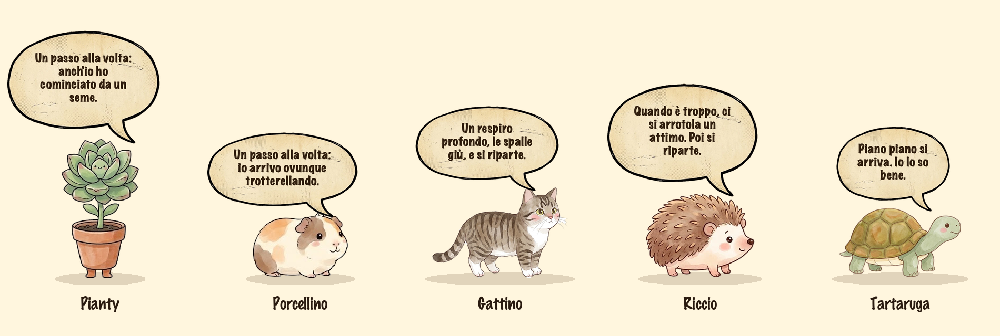
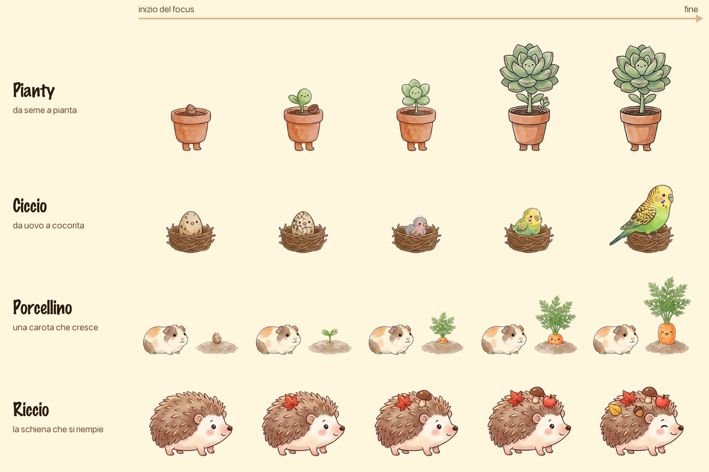

  

<h1 align="center">FocusFriends</h1>

  <b>Il compagno che ti accompagna mentre studi.</b> 
  Un piccolo amico che vive sul tuo schermo: cammina sul desktop, ti tiene il tempo del focus 
  e ti dice le parole giuste per continuare.

  Per Mac e Windows · gratis · senza account · i tuoi dati restano sul tuo computer

  <a href="https://github.com/jaacopocoding/FocusFriends/releases"><b>Scarica</b></a> &nbsp;·&nbsp; <a href="docs/GUIDA.md">Guida completa</a>

  

 

## Scegli chi ti fa compagnia

  

Cinque amici, ognuno con il suo carattere e le sue frasi. Il primo lo scegli tu, gli altri si sbloccano studiando.

 

## Ti dice due parole quando serve

  

Ogni tanto, senza distrarti: un incoraggiamento, un «respira», un «bevi un po' d'acqua». Puoi scrivere le tue.

 

## Il timer, in un tocco

  

Scegli i minuti, scrivi cosa studi, premi inizio. Se vuoi, una pausa lunga ogni quattro focus.

 

---

## E in più

**Mentre studi, cresce anche lui.** Pianty da seme a pianta, l'uovo di Ciccio che si schiude, la carota del Porcellino, la schiena del Riccio che si riempie d'autunno.

  

**Un giardino da riempire.** Studiando trovi figurine: le metti sulle tue isole, dove vuoi, quante volte vuoi. E un album da completare.

<table align="center">
  <tr>
    <td></td>
    <td></td>
  </tr>
  <tr>
    <td colspan="2" align="center"></td>
  </tr>
</table>

Le isole sono nel codice di questo ramo; la versione scaricabile ha ancora un'isola sola.

**Sai dove va il tuo tempo.** Statistiche per materia, giorni di fila, e una lista di cose da fare con la scadenza.

<table align="center">
  <tr>
    <td></td>
    <td></td>
  </tr>
</table>

 

## Scarica

**Mac** (macOS 13 o successivo) · dalle [Releases](https://github.com/jaacopocoding/FocusFriends/releases) scarica lo zip, trascina l'app in *Applicazioni* e aprila. La prima volta: clic destro → **Apri**.

**Windows** (10 e 11) · dalle [Releases](https://github.com/jaacopocoding/FocusFriends/releases) scarica l'installer. La prima volta: *Ulteriori informazioni* → *Esegui comunque*. Il giardino non c'è ancora.

L'app non è firmata con un account sviluppatore, per questo il sistema chiede conferma. Tutto il resto è nella [guida](docs/GUIDA.md).

 

---

  <a href="docs/GUIDA.md">Guida</a> ·
  <a href="ARCHITECTURE.md">Architettura</a> ·
  <a href="FORMATI.md">Formati dei dati</a> ·
  <a href="CREDITS.md">Crediti</a> ·
  <a href="LICENSE">Licenza MIT</a>

