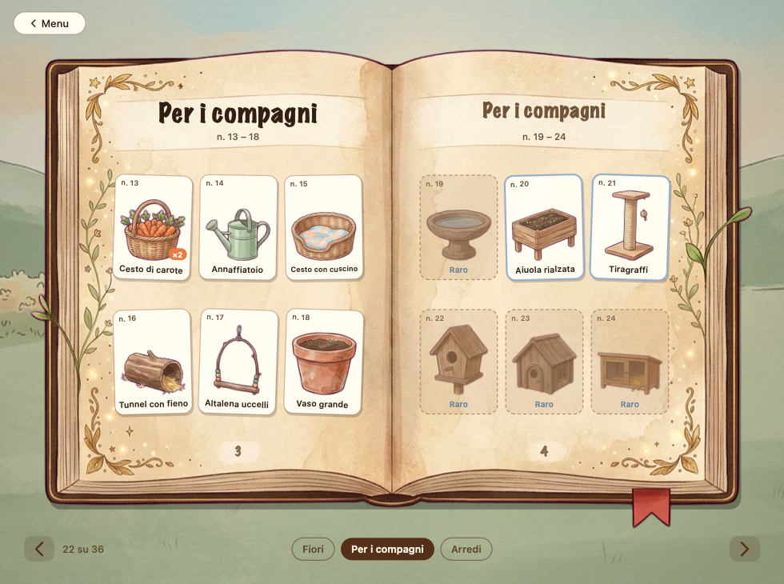
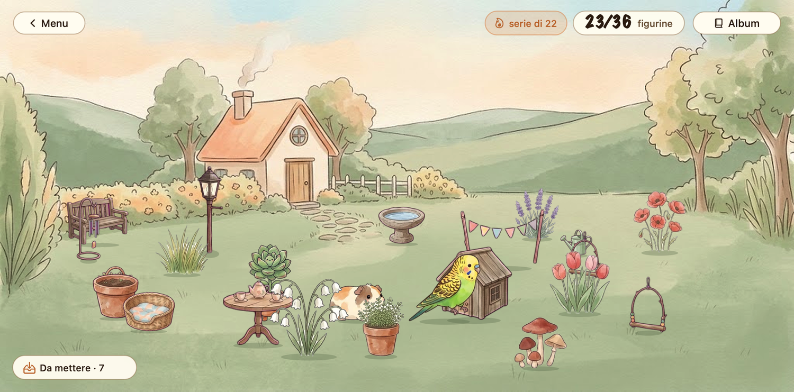
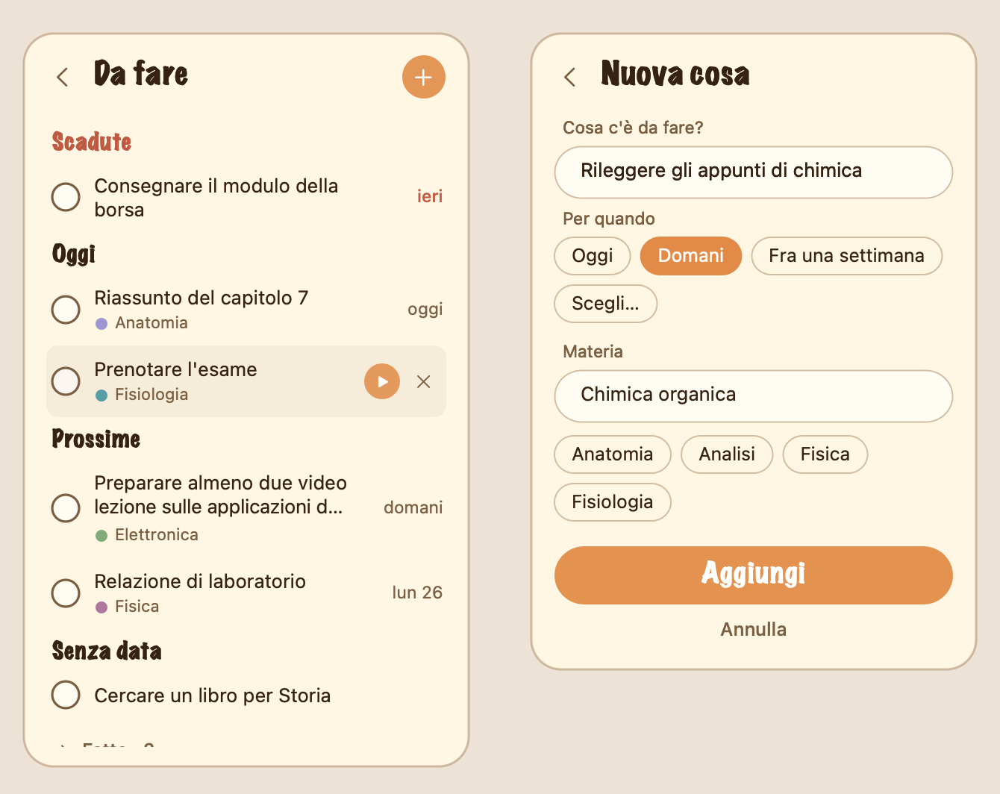

<p align="center">
  
</p>

<h1 align="center">FocusFriends</h1>

<p align="center">
  Un compagno che vive sul desktop del Mac, ti tiene compagnia mentre studi e cresce con il tuo tempo di focus.<br>
  Pomodoro, materie, statistiche e un giardino tutto tuo, che si riempie con le figurine di un album: ne puoi trovare una a ogni focus completato.
</p>

<p align="center">
  
</p>

## I compagni

- **Pianty**, una succulenta con due piedini: cresce mentre lavori (parte da un seme e, man mano che il tempo
  del focus passa, diventa una pianta adulta) e cammina per lo schermo. È il personaggio di partenza.
- **Porcellino**, una cavia che cammina per lo schermo, mangia la carota, fa i pisolini e saltella, con frasi sue.
- **Ciccio**, una cocorita che cammina e ogni tanto sbatte le ali, con frasi sue.
- **Gattino**, un gatto soriano che cammina per lo schermo, mangia un pesce, dorme e ogni tanto si lecca la zampa, con frasi sue.

### Si sbloccano studiando

Alla prima apertura scegli il tuo compagno, ed è libero. Gli altri si guadagnano studiando: il **secondo a 20
focus**, il **terzo a 50** e il **quarto a 100**, dove un «focus» sono 50 minuti di studio (contano
tutti i minuti, anche quelli dei focus interrotti, e un timer da 5 minuti non sblocca niente più in fretta). Nella
scheda del menu i compagni ancora bloccati hanno un lucchetto e la frase di quanto manca («Porcellino si sblocca a 20
focus: ne hai 12»); quando arriva il momento, a fine focus il personaggio lo annuncia. Lo sblocco si ricorda
(`profilo.json`) e non si richiude, anche se poi cancelli delle sessioni; chi usava già l'app li ha tutti da subito.
Le regole sono in `CompanionRewards.swift` (solo Foundation, con prove). *Cancella tutto…* rifà la presentazione,
e quindi anche la scelta del primo compagno.

Chi sviluppa può avere tutti i compagni subito, senza toccare il profilo: da Terminale
`defaults write com.jacopo.focusfriends developerMode -bool true` (e `-bool false` per spegnerlo).

Durante un focus ognuno ha il suo modo di crescere con te: Pianty da seme a pianta, Ciccio da uovo a cocorita
nel suo nido, il Porcellino guarda crescere una carota e, se finisci il focus, la mangia.

<p align="center">
  
</p>

## Un'occhiata

| | |
|---|---|
|  |  |
| Alla prima apertura: come ti chiami e chi ti fa compagnia. | All'avvio di un focus: la materia, oppure una recente. |

**Com'è andata?**: a fine focus un tocco su una faccia e, se vuoi, una riga su cosa hai fatto. Il tempo da solo
inganna: così a fine settimana vedi anche *quando* rendi meglio.

<p align="center">
  
</p>

**Statistiche**: un riepilogo calmo (il totale in grande, le materie in una barra, i giorni di fila e «Com'è andata»)
e, da «Mostra le sessioni», una tendina sotto il riepilogo con la nota e la faccia di ogni focus.

<p align="center">
  
  &nbsp;&nbsp;
  
</p>

**Il giardino e l'album**: ogni focus completato (almeno 20 minuti di studio) può regalarti una figurina, che appare
accanto al personaggio. Le figurine stanno in un **album** da collezionare, un libro antico in una finestra tutta sua, e
le copie che trovi le metti sull'**isola** del giardino, che è tua: una griglia di tessere vista di sbieco, da 8×8 che si
allarga completando le pagine dell'album. I compagni sbloccati ci camminano, e se li tocchi parlano.

<p align="center">
  
  &nbsp;&nbsp;
  
</p>

> Le schermate usano dati di esempio.

## Scaricare e usare

1. Scarica `FocusFriends-0.10.0-macOS.zip` dalla pagina delle [Releases](https://github.com/jaacopocoding/FocusFriends/releases) e decomprimilo.
2. Trascina **FocusFriends** in *Applicazioni* e aprilo (macOS 13 o successivo, Apple Silicon e Intel).
3. L'app non è firmata con un account sviluppatore Apple, quindi la prima volta macOS potrebbe rifiutarla.
   Fai clic destro sull'app → **Apri** → **Apri**, oppure da Terminale:

   ```bash
   xattr -dr com.apple.quarantine /Applications/FocusFriends.app
   ```

   Per controllare che lo zip scaricato sia quello pubblicato, il checksum SHA-256 di ogni versione è nelle note
   della release (`shasum -a 256 FocusFriends-<versione>-macOS.zip`).

**Windows.** C'è anche una versione per Windows 10 e 11 (Electron, nella cartella [`windows/`](windows/)): dalla pagina delle Releases scarica
`FocusFriends-Windows-<versione>-x64-Setup.exe` (o `…-arm64-Setup.exe` per i computer ARM) e lancialo; non è firmato, quindi la prima volta
Windows può mostrare «Windows ha protetto il PC» (*Ulteriori informazioni* → *Esegui comunque*). Ha tutto tranne il giardino, che arriva con la
prossima uscita. I dati (uguali per i due sistemi, vedi [`FORMATI.md`](FORMATI.md)) stanno in `%APPDATA%\FocusFriends`. Il piano e lo stato sono in
[`PIANO_WINDOWS.md`](PIANO_WINDOWS.md), il confronto con questa app in [`windows/PARITA.md`](windows/PARITA.md).

Non ha icona nel Dock: la trovi nella barra dei menu e con il tasto destro sul personaggio. I dati (sessioni,
nome) restano sul tuo Mac, in `~/Library/Application Support/FocusFriends/`: nessuna rete, nessun invio.

## Cosa fa

- Compare nell'angolo in basso a destra, sempre sopra le altre finestre e su tutti gli Spaces.
- Ogni 40–110 secondi mostra un fumetto con una frase (la prima dopo 5 secondi dall'avvio). Il fumetto sta sempre
  **sopra tutto ciò che si vede** del personaggio: si alza se cresce, se spalanca le ali o salta, e scende piano quando
  si abbassa; se il personaggio è in alto sullo schermo e sopra non c'è posto, sta di fianco.
- Si può trascinare dove si vuole; fumetto e orologio lo seguono.
- Non ha icona nel Dock: si controlla dalla barra dei menu o con il tasto destro sul personaggio.

## Il menu

Un clic sull'icona nella barra dei menu (o il tasto destro sul personaggio) apre la **scheda del menu**
(`MenuCard.swift`): il compagno sbuca dal bordo, e sotto ci sono i compagni (tocca un nome per cambiarlo), i
focus da 30 e 50 minuti e la pausa, il riepilogo di oggi, *Giardino* e *Statistiche* e le impostazioni più usate.
Toccando il compagno parla; mentre il timer va, un clic sull'icona (o il tasto destro, o ctrl-clic, sul personaggio) apre invece la
[schermata del focus](#la-schermata-del-focus) (o quella della pausa), con *‹ Menu completo* per tornare alla scheda.
Se l'hai aperta dal personaggio, **lo segue** quando cammina o lo trascini (passa dall'altro lato se arriva al bordo dello schermo). Si chiude con un clic fuori o con Esc. Le schermate che si aprono da lì (la scelta della materia, le statistiche, il giardino)
hanno una **freccia indietro** (‹, a sinistra del titolo; il pulsante «‹ Menu» in alto a sinistra nelle finestre) che le chiude e
riapre la scheda dov'era, senza ricominciare da capo. *Altri timer…* e *Altre impostazioni…* aprono il menu classico, che si
apre anche con il tasto destro (o ⌥-clic) sull'icona nella barra dei menu:

<p align="center">
  
</p>

**Altri timer…** apre «Gira il timer»: un quadrante a forma di pomodoro in cui si trascina il pallino (o si usa la
rotella, un minuto alla volta) per scegliere i minuti, da 5 a 120 per un focus e da 1 a 30 per una pausa. Sotto,
i timer che hai: si toccano per metterli sul quadrante. Un valore nuovo si può *salvare tra i miei timer* (fino a 6
per tipo) e uno tuo si può *rimuovere*. *Avvia* parte con i minuti scelti; la pausa scelta parte da sola dopo ogni focus.

<p align="center">
  
</p>

### Il menu classico

| Voce | Cosa fa |
|---|---|
| Nascondi / Mostra | Lo toglie dallo schermo o lo rimette |
| Fai parlare | Mostra subito una frase |
| Pomofocus ▸ | Timer: *Focus 30/50 min*, *Pausa 5/10 min*, *Personalizza…*, *Ferma timer* |
| Statistiche e riepilogo… | La finestra con il riepilogo di oggi e le statistiche della settimana, del mese e dell'anno |
| Il mio giardino… | La tua isola: le figurine da mettere, gli oggetti e i compagni (con il tuo nome: «Il giardino di …») |
| Album | L'album delle figurine, con quante ne hai trovate e quante sono nuove |
| Il tuo nome… | Cambia il nome che compare nei titoli |
| Chiedi com'è andata | Se a fine focus compare «Com'è andata?» (spunta = sì) |
| Pausa lunga dopo 4 focus | Dopo quattro focus completati di fila la pausa dura 15 minuti (spunta = sì) |
| Frequenza delle frasi ▸ | *Spesso* / *Ogni tanto* / *Raramente* / *Mai* |
| Personaggio ▸ | Sceglie il personaggio (la scelta resta alla riapertura) |
| Movimento ▸ | *In movimento* / *Fermo*: per i personaggi che camminano |
| Avvia al login | Si avvia da solo all'accensione del Mac |
| Modifica le frasi… | Apre il file delle frasi del personaggio attivo |
| Esci da FocusFriends | Chiude l'app |

## Da fare

Nella scheda del menu c'è la riga **Da fare** (a destra, quante cose restano). Apre una pagina per segnarsi le cose da ricordare:

- **Si aggiunge** con il **«+»** in alto a destra, che apre la pagina *Nuova cosa*: il nome (già pronto da scrivere), la **scadenza**
  (*Oggi*, *Domani*, *Fra una settimana*, oppure *Scegli…* con un calendario) e la **materia** (si scrive, o si tocca una di quelle usate
  di recente), poi *Aggiungi* (o Invio). La scadenza è un giorno, senza ora; scadenza e materia sono facoltative. Con *Annulla*, la freccia
  o Esc nei campi si torna alla lista senza salvare.
- **La lista** è divisa in *Scadute*, *Oggi*, *Prossime* e *Senza data*; accanto a ogni voce c'è la scadenza («ieri», «oggi»,
  «domani», «ven 23», «26 ott»).
- **Toccando il testo di una voce** si apre la stessa pagina, *Modifica*, già compilata: si cambiano nome, scadenza e materia. I nomi lunghi vanno
  a capo (fino a due righe).
- **Il cerchio** segna una voce come fatta: va in fondo, tra le *Fatte*, e dopo una settimana sparisce. Toccandolo di nuovo torna da fare.
- **Sotto il mouse** compaiono ▶ *Inizia un focus* e × *Togli*. Il ▶ porta al quadrante *Gira il timer* (con «Focus per…» in alto, e come punto di
  partenza l'ultima durata usata): scegli i minuti e *Avvia il focus* parte con la materia della voce, senza richiedertela. Se la voce non ha una
  materia, dopo i minuti si apre «Cosa studi adesso?». La freccia torna alla lista.
- **Quando il focus finisce** (se era partito dal ▶ di una voce ancora da fare), la scheda di fine focus aggiunge «Hai finito «Riassunto del
  capitolo 7»?» con *Fatta* e *Non ancora*: *Fatta* segna la voce e il compagno ti fa i complimenti, *Non ancora* la lascia in lista. Se hai spento
  «Chiedi com'è andata» la scheda ha solo questa domanda. Se il focus è stato fermato prima della fine, non chiede niente.
- **Il compagno** ogni tanto ricorda le scadenze di oggi, o di domani («Domani scade «Esercizi di analisi». Un focus adesso?»):
  al posto di una frase a caso, al massimo una volta ogni tre ore, mai durante un focus e mai con *Frasi: Mai*.

Le voci stanno in `dafare.json`, accanto a `sessioni.json` (il formato è in [`FORMATI.md`](FORMATI.md) §9); *Cancella tutto…* delle
statistiche non le tocca. «Da fare» c'è anche nella versione per Windows (dalla 1.1).

<p align="center">
  
</p>

## Pomofocus

Dal menu *Pomofocus* scegli un focus di 30 o 50 minuti: sotto il personaggio compare un mini orologio
digitale con il conto alla rovescia. L'orologio resta visibile per i primi 2 minuti di ogni fase, poi si
ritira; ricompare con un'animazione a tendina quando passi il mouse sul personaggio, e resta sempre
visibile quando mancano 5 minuti o meno. Alla fine del focus suona un avviso e, per 10 secondi, compare accanto al personaggio il pulsante **«+5 minuti»**
(`ExtendPrompt.swift`, con una barretta che si svuota): se lo tocchi il focus continua per altri 5 minuti (e si può
ripetere), altrimenti parte da sola la pausa (5 minuti, oppure l'ultima durata scelta tra *Pausa 5 min* e *Pausa 10 min*, segnata con la spunta).
Alla fine della pausa l'orologio sparisce. Durante il focus il personaggio parla più di rado, per non
distrarti.

**Pausa lunga**: dopo **quattro focus completati di fila** la pausa che parte da sola è lunga, **15 minuti** (o la
tua pausa scelta, se è già più lunga), e il personaggio lo dice; la schermata della pausa diventa «Pausa lunga».
Poi il conteggio riparte da zero. Sotto il titolo della schermata del focus quattro puntini dicono a che punto
sei («Focus 3 di 4»; nella pausa, «2 di 4 fatti»). I focus interrotti non contano e non azzerano il ciclo; se tra un focus e il
successivo passano più di due ore, si ricomincia da capo (`BreakCycle.swift`, con prove). Si spegne dal menu
classico, voce *Pausa lunga dopo 4 focus*; spenta, la pausa è sempre quella scelta.

**Timer personalizzati**: *Pomofocus ▸ Personalizza…* apre una finestra per aggiungere un focus (1–180 min) o
una pausa (1–60 min). I timer aggiunti (al massimo 6 per tipo, senza doppioni) compaiono nel menu in ordine di
durata insieme a quelli di serie, si ricordano alla riapertura (`CustomTimers.swift`) e si tolgono da *Rimuovi
un timer personalizzato*. Valgono per tutti i personaggi.

## La schermata del focus

Quando un focus è in corso, un clic sull'icona (o il tasto destro, o ctrl-clic, sul personaggio) non apre il menu ma la
**schermata del focus**:
una pagina di quaderno con la materia, da che ora a che ora dura, il compagno e un grande pomodoro-timer con
l'arco del tempo passato e quello che manca.

<p align="center">
  
</p>

Sotto il pomodoro:

- **+ 5 minuti** aggiunge cinque minuti al focus (anche prima della fine; si può ripetere); **Ferma** ferma solo il
  conto alla rovescia e resta nella schermata: il pulsante diventa **Riprendi**. Il tempo da fermo non conta nello
  studio (nemmeno se l'app si chiude di colpo: nel file del focus in corso resta scritto quanto è stato fermo), e il
  suono ambiente o la musica si fermano e ripartono con lui. Da fermo compare **Termina e salva**: chiude
  il focus tenendo i minuti fatti (sotto il minuto non viene registrato, come sempre) e le note;
- **Sottofondo**: *Nessuno*, *Pioggia*, *Vento*, *Marrone* o *Musica* (uno alla volta) e il volume. Il suono si
  sente solo durante il focus; la musica sono i brani inclusi, o la tua cartella la prima volta;
- **Note**: un foglietto per appuntare al volo quello che ti passa per la testa mentre studi («chiedere al prof…»).
  Scrivi e premi Invio; le note si salvano subito con il focus (non si perdono se l'app si chiude) e si rivedono
  nelle statistiche, sotto la sessione, e nel CSV (colonna `note_del_focus`). Fino a 40 note da 160 caratteri;
- **Elimina questo focus**: chiede conferma e poi lo butta come se non fosse mai iniziato (niente minuti, niente
  piantina, niente note).

Durante la **pausa** la stessa pagina diventa verde: il tempo di pausa che resta, **+ 5 minuti** e **Salta**,
«Bevi un po' d'acqua e guarda lontano.», **Nuovo focus** (con gli stessi minuti dell'ultimo) e, se non l'hai già
fatto, **Com'è andata?** con le tre facce per l'ultimo focus, più i collegamenti a giardino e statistiche.

## Il tuo nome e il compagno

La prima volta che si apre l'app (anche per chi la usava già) compare la scheda di introduzione
(`IntroCard.swift`): **come ti chiami** e **chi ti fa compagnia** (Pianty, Porcellino, Ciccio o il Gattino). Entrambi sono
facoltativi: *Salta* o Esc lasciano tutto com'è. Il nome personalizza i **titoli**: il giardino diventa
«Il giardino di Marco» e le statistiche «Le statistiche di Marco» (nelle voci di menu e nei titoli delle finestre).
Senza nome restano «Il mio giardino» e «Statistiche e riepilogo». Si cambia in ogni momento da *Il tuo nome…* nel
menu; il compagno da *Personaggio*.

Il nome sta in `profilo.json` (`{"version": 1, "name": …, "introSeen": …}`), accanto a `sessioni.json`, ed
è gestito da `Profile.swift`. **Non è scritto nelle sessioni**: i titoli si compongono al momento, quindi
cambiando il nome cambia ovunque. Viene pulito (spazi in eccesso, al massimo 24 caratteri, maiuscole come
scritte), non esce dall'app (non c'è nell'esportazione CSV) e *Cancella tutto…* lo toglie insieme ai dati
(alla riapertura ricompare la scheda di introduzione).

## Materia e statistiche

Quando si avvia un focus compare la scheda **"Cosa studi adesso?"** (`SubjectPrompt.swift`): si scrive la
materia, oppure si tocca una di quelle usate di recente per partire subito, oppure si sceglie *Senza materia*
(Esc annulla e il focus non parte). Durante il focus la materia compare nell'intestazione del menu
("Focus · Anatomia · 24:10"), e a fine focus il personaggio dice qualcosa come *"Hai studiato Anatomia per
50 minuti. Che bel lavoro!"*.

Ogni focus finisce in un registro (`SessionLog.swift`), un file leggibile in
`~/Library/Application Support/FocusFriends/sessioni.json`: inizio, ora "sull'orologio" a cui è iniziato,
minuti fatti davvero, minuti previsti, completo o interrotto, materia, personaggio. È un JSON con la versione del
formato (`{"version": 3, "sessions": […]}`). Le regole:

- le pause non contano; un focus **interrotto** conta per i minuti che ha fatto davvero, se sono almeno uno;
- una sessione che passa la mezzanotte va al giorno in cui è iniziata, **secondo l'orologio di quando l'hai
  fatta**: se poi cambia il fuso orario o l'ora legale, non cambia giorno (né ora) (`localStart`);
- **le materie si uniscono**: "Anatomia", "anatomia" e "ANATOMIA" (e le versioni con o senza accenti) sono
  la stessa materia; una nuova scrittura prende quella già usata, e nelle sessioni si può cambiare il nome in
  tutte insieme (nella finestra di modifica: «Cambia la materia in tutte le sessioni»);
- se l'app si chiude di colpo durante un focus, la sessione si recupera al prossimo avvio come interrotta
  (un piccolo file `in-corso.json` si aggiorna ogni 30 secondi);
- **copia di sicurezza**: una al giorno, fatta prima della prima modifica, nella cartella `backup/` (le ultime
  7); quando il formato passa a una versione nuova viene tenuta intatta anche la copia di quello vecchio;
- se `sessioni.json` risulta illeggibile viene messo da parte (`sessioni.corrotto-….json`) e si riparte da vuoto;
  se è di una versione **più nuova** di quella dell'app viene letto ma non riscritto, per non perdere nulla;
- **cancellare tutto**: *Cancella tutto…* nella finestra delle statistiche elimina le sessioni, il focus in
  corso e anche le copie di sicurezza (con conferma; prima si può esportare in CSV).

### Com'è andata e cosa hai fatto

A fine focus (se è stato completato) compare **«Com'è andata?»** (`ReflectionCard.swift`): tre facce, *Bene*,
*Così così*, *Poca testa*, e una riga facoltativa «Cosa hai fatto?» (al massimo 80 caratteri). Un tocco su una
faccia salva e chiude; scrivere solo la nota e premere Invio (o *Fatto*) salva la nota; *Salta* o Esc chiudono
senza salvare. La scheda sta accanto al personaggio, **non prende la tastiera** (a fine focus potresti stare
scrivendo altrove: la prende solo se ci clicchi nel campo) e **non blocca niente**: la pausa parte comunque, e se
la ignori sparisce da sola quando la pausa finisce o parte un altro focus. Non compare per i focus interrotti.
Il personaggio risponde al voto (con «Poca testa» dice che capita, non fa i complimenti). Si spegne dal menu con
*Chiedi com'è andata*.

Voto e nota stanno nella sessione (`rating`: `good`, `soso`, `poor`; `note`) e si cambiano toccando la sessione
nelle statistiche. All'avvio di un focus la scheda della materia ricorda l'ultima nota («L'ultima volta su
Anatomia: nervi cranici»). In *Statistiche* c'è la sezione **Com'è andata**: quante volte bene / così così /
poca testa nel periodo e, quando ci sono almeno 8 focus valutati, fino a due frasi su **quando** (fascia della
giornata, giorno della settimana) o **con cosa** (materia) i focus vanno meglio o peggio, sempre con i
conteggi («di mattina: 7 focus su 9 sono andati bene»). Un gruppo deve avere almeno 3 focus e distare almeno 20
punti percentuali dalla media: altrimenti non dice niente, meglio che dire una cosa a caso (`StudyStats.insights`).
Il CSV ha tre colonne in più (`com_e_andata`, `nota`, `note_del_focus`) e i campi di testo che iniziano con `= + - @`, un tab o un ritorno a capo hanno un
apice davanti, così un foglio di calcolo non li prende per formule.

Il formato del file passa alla **versione 2** (voto e nota) e poi alla **3** (le note scritte durante il focus):
un file di una versione precedente si legge e si riscrive nel nuovo, tenendo intatta la copia del vecchio in
`backup/sessioni-formato<N>.json`.

*Statistiche e riepilogo…* apre una finestra (`DashboardWindow.swift`) con quattro schede: **Oggi**, **Settimana**
(da lunedì), **Mese** e **Anno**. Con le frecce si va ai periodi precedenti. Il **riepilogo** è fatto per essere calmo:
il totale di studio in grande, quanti focus (completi e interrotti), le barre sottili dei giorni (settimana e mese),
una sola barra a segmenti con le materie e la sua legenda, i giorni di fila e come è andata (con le frasi su
quando rendi meglio, se ci sono dati sufficienti). Sotto, **Mostra le sessioni** apre una **tendina nella stessa
pagina** (il riepilogo resta sopra): per un giorno, una striscia con un blocco colorato per ogni focus sulle ore e
l'elenco con ora, materia, nota, faccia e durata; per una settimana o un mese, le sessioni sotto il loro giorno (con il
totale del giorno). La finestra resta della stessa altezza: la pagina scorre con la rotella. Toccando una sessione si
cambia la materia, la nota, le note del focus e il voto, o la si elimina; *Esporta CSV…* salva tutte le sessioni per un foglio di
calcolo. I dati restano sul Mac: nessun invio da nessuna parte.

**La scheda Anno** (`YearStats.swift`, con prove) mostra l'anno di calendario come una mappa con **un quadratino per giorno** (una colonna per settimana, da lunedì), nel verde:
più chiaro per i giorni con poco studio, più scuro per quelli con tanto. Le soglie sono fisse: meno di 30 minuti, meno di 90, meno di 3 ore, 3 ore o più (un giorno da due ore ha lo stesso colore in tutti gli anni).
I giorni che devono ancora arrivare sono tratteggiati, e oggi ha un contorno. Passando sopra un giorno si legge «Venerdì 2 ottobre · 2 h 10 · 3 focus»; **cliccandolo** si apre quel giorno in *Oggi*, con le sue sessioni.
Sotto la mappa, tre numeri (la serie di giorni di fila più lunga dell'anno, il giorno più forte, il mese migliore) e **l'andamento per settimana**: barre con le ore di ogni settimana,
di tutte le materie o di una sola (le materie più studiate dell'anno, scelte con un clic). L'andamento si mostra da quattro settimane con studio in su, e le materie solo se sono almeno due. Si ricava tutto dal registro: nessun dato nuovo.

Le regole di calcolo hanno le loro prove: `./tests/run.sh` (compila `SessionLog.swift` da solo e controlla
periodi, totali, giorni di fila e serie ghiacciata, regali di fine focus e album, copie nel prato, recupero, file
rovinato, migrazione, materie unite, copie di sicurezza, fuso orario…).

## Il giardino e l'album

*Il mio giardino…* (`GardenWindow.swift`) è un'**isola tua**: un posto calmo, da riempire con quello che trovi. Non
conta i focus e non misura niente: le cifre dello studio stanno nelle *Statistiche*. Il giardino e l'album sono due
finestre diverse: il libro serve a collezionare e a guardare, l'isola a mettere le cose dove vuoi.

<p align="center">
  
</p>

### I regali di fine focus

A ogni focus **completato** con almeno **20 minuti** di studio (`GardenDrops.minimumSeconds`) il personaggio dice se hai
trovato una figurina, e questa compare accanto a lui per qualche secondo (`GiftCard.swift`). Un focus interrotto o più
corto non dà e non toglie niente. Le regole, tutte in `GardenDrops.swift` (solo Foundation, con prove):

- **Qualche volta non esce niente**: una volta su cinque, ma mai più di due di fila.
- **Tre rarità**: comune, raro (bordo d'argento) e leggendario (bordo d'oro con le stelline). Parti dal 22 % di raro e dal
  3 % di leggendario; con la serie salgono (da 3, 7 e 14 giorni di fila) e un focus da 45 minuti in su dà un po' più di
  raro. Le garanzie: al massimo 10 regali senza un raro e 40 senza un leggendario.
- **Di norma esce qualcosa che non hai** (4 volte su 5, se ce n'è ancora). Un doppione non si perde: è una **copia** in
  più, da mettere nel prato.
- **Il tiro non si ripete chiudendo l'app**: dipende solo dall'identificativo del focus e da quello che hai già trovato
  (FNV-1a e Mulberry32, uguali in TypeScript per quando arriverà su Windows). Lo stesso focus non tira due volte.

**La serie ghiacciata.** Un giorno senza studio non azzera la serie: la **ghiaccia**. Il numero resta fermo
(nella scheda del menu, nelle statistiche e nel giardino compare un fiocco di neve) e, se studi il giorno dopo,
continua da dov'era. Due giorni di fila senza studio la azzerano, e il ghiaccio si può usare **una volta ogni 7
giorni** (`StudyStreak` in `GardenPoints.swift`), altrimenti basterebbe studiare a giorni alterni. Se oggi non hai
ancora studiato non si giudica niente: la giornata non è finita.

### L'album

Si apre dalla riga **Album** del menu (sotto «Da fare») o dal pulsante nel giardino (`AlbumWindow.swift`). Si vede
prima la copertina, che dice quante figurine hai e quante sono nuove; un tocco la apre, girando attorno al dorso, sulla
doppia pagina delle figurine nuove. Ogni sezione del catalogo (**Fiori**, **Per i compagni**, **Arredi**: 36 figurine
in tutto, per ora) occupa una doppia pagina da sei per lato. Le figurine trovate sono incollate un po' storte, con il
numero, il nome e un ×2 se ne hai due copie; le altre sono caselle tratteggiate con la sagoma e la rarità. Si sfoglia con
le frecce, le linguette delle sezioni, la tastiera o due dita sul trackpad; un tocco su una figurina dice quante copie hai.
Quando una doppia pagina è tutta trovata compare un sigillo «completa».

<p align="center">
  
</p>

Il libro è disegnato (`assets/album/copertina.png` e `doppia_pagina.png`, fatti con un generatore di immagini) e sopra ci
vanno titoli, figurine e numeri, scritti dall'app. Dietro c'è il prato del giardino. Le animazioni (la copertina che si
apre, la pagina che gira) sono fogli in 3D con un davanti e un dietro, fatti da foto del libro; con *Riduci movimento*
nelle impostazioni di accessibilità il libro si apre e si sfoglia di colpo.

### L'isola e la cassetta

L'isola è una griglia di **tessere** vista di sbieco, con un sentiero che la attraversa (ci camminano i compagni, ma non
ci si costruisce) e il prato del giardino sfocato dietro. Parte da **8×8** e si allarga di una fila per ogni doppia
pagina dell'album completata, fino a **10×10** (`GardenIsland`, in `GardenGrid.swift`). Ogni oggetto occupa una, due o
quattro tessere (la panchina 2×1, la casetta del gatto 2×2…), sempre della stessa misura, quindi niente sovrapposizioni.

Il terreno è **disegnato**: dodici tessere d'erba (liscia, con ciuffi, trifogli, margheritine, fiorellini, sassi, foglie, muschio, erba alta) e otto
di sentiero (lastre, ciottoli, pietre irregolari, con l'erba o col muschio). Vanno a **chiazze di 2 o 3 uguali** di seguito, in modo sempre uguale
per la stessa tessera (`GardenTerrain`, in `GardenGrid.swift`) e senza cambiare quando l'isola si allarga. In autunno prendono una tinta ocra;
d'inverno, finché non c'è la neve disegnata, si usa il terreno bianco disegnato dal codice.

I **lati dell'isola** sono strisce di terra disegnate (`assets/giardino/bordo_1..3.png`): una zolla vista di fronte con il bordo d'erba, radici, sassi e
muschio. Si ripetono sui due lati, sempre diverse dalla precedente e sovrapposte con le estremità che svaniscono (il lato destro, all'ombra, è più scuro),
e i fili d'erba che sporgono coprono un po' il bordo delle tessere.

Sopra il terreno si spargono **dettagli** disegnati (`assets/giardino/dettaglio_1..24.png`, da un foglio su magenta): ciuffi d'erba, trifogli, fiorellini
bianchi, rosa, gialli e azzurri, sassi, e secondo la stagione petali (primavera), foglie (autunno) e ciuffi di neve (inverno). Quali e dove dipende solo
dalla tessera e dalla stagione (`GardenTerrain.decals`), quindi non cambiano a ogni apertura; sul sentiero ce ne sono pochi.

In basso a sinistra, **Da mettere · N** apre la cassetta con le copie che hai trovato e non hai ancora messo:

- un tocco ne mette una su una tessera libera, trascinandola la metti dove vuoi: **le tessere sotto il mouse diventano
  verdi se ci sta, rosse se no** (sentiero, fuori dall'isola, sopra un'altra cosa) e la copia si appoggia sulla tessera
  più vicina; **ne puoi mettere quante sono le copie che hai** (con un solo girasole, un solo girasole sull'isola);
- si trascina tutto: dalla cassetta all'isola per metterlo, sull'isola per spostarlo; **R** mentre lo trascini (o il tasto
  destro → *Gira*) lo gira, e per toglierlo lo si lascia nella zona tratteggiata che compare in basso a sinistra (o tasto
  destro → *Togli dal giardino*): la copia torna tra quelle da mettere;
- i **compagni** camminano da soli, ogni tanto, sulle tessere libere accanto; se li trascini dove vuoi, lì è casa loro, e
  se li tocchi parlano.

**Zoom e spostamenti.** Si ingrandisce con il pizzico sul trackpad (attorno al mouse), con ⌘ o ⌥ e la rotellina, coi
tasti `+` e `−` o coi pulsanti in basso a destra (da 0,6× a 2,5×); `0` o il pulsante in mezzo rimettono tutta l'isola, e
due tocchi sullo sfondo ingrandiscono o tornano indietro. Ci si sposta con due dita o trascinando lo sfondo; il centro
della finestra resta sempre sull'isola.

**Luce e stagioni.** Il giardino segue l'orologio e la data (`GardenSky.swift`): alba rosata, giorno, tramonto dorato, crepuscolo e
notte blu, con il sole che sorge e tramonta a ore diverse (d'inverno alle 17 è già buio, d'estate alle 21 c'è ancora luce). Con il buio
i **lampioni** si accendono, con un alone in cima e una pozza di luce sul prato, e compaiono le **lucciole** (tante d'estate, poche in
autunno, mai d'inverno). La stagione cambia l'erba e il velo sullo sfondo: in primavera cadono i petali, in autunno le foglie, in inverno
la neve e l'isola è bianca. Per provare un'ora o una stagione: `defaults write com.jacopo.focusfriends gardenHour -float 21` (l'ora, con
la virgola) e `gardenSeason -string winter` (`spring`, `summer`, `autumn`, `winter`); `defaults delete …` le toglie.

**Un po' di vita.** Fiori, erba, felci, bandierine e carillon **ondeggiano** col vento (più forte in autunno e in inverno, quasi niente
d'estate), con un'onda che attraversa l'isola; l'**acqua del bagnetto** luccica e ogni tanto fa un cerchio, come per una goccia; dal
**camino** del casale sale il fumo (tanto d'inverno, un filo d'estate) e di sera si accendono le sue finestre. Con «Riduci movimento»
nelle impostazioni di accessibilità tutto sta fermo (anche neve, lucciole e compagni che camminano); il giardino si ridisegna solo con la
finestra visibile e non coperta.

Sopra l'isola, due etichette: quante figurine hai (N/36) e la serie di giorni. Gli oggetti, le impronte e le rarità stanno
in `GardenCatalog.swift` (per ora la rarità si ricava dal vecchio prezzo: fino a 3 comune, fino a 6 raro, oltre leggendario).

### Chi veniva dal negozio

Fino alla 0.9 il giardino si riempiva con i **punti** (uno per ora di studio) spesi in un negozio. Alla prima apertura
della 0.10 il file passa al formato nuovo e **non si perde niente**: gli oggetti già sbloccati diventano figurine trovate
(con tante copie quante ne avevi nel prato, almeno una) e i punti non spesi diventano **regali da aprire** (uno per
punto), che si aprono come i regali di fine focus, la prima volta che apri il giardino o l'album. Le cose che avevi messo
nel prato libero vanno sulla tessera libera più vicina a dove stavano, e quelle che non ci stanno (l'isola è piena)
tornano tra le copie da mettere. L'ultimo file in formato vecchio resta accanto, come `giardino-formato1.json` o
`giardino-formato2.json`. La 0.9 non legge il formato nuovo.

### I compagni nel giardino

I compagni **sbloccati** stanno sul prato (quelli bloccati no). Li trascini dove vuoi, e se ne tocchi uno dice una
delle sue frasi. Non si comprano e non si tolgono: sono casa loro.

### Dove sta

`giardino.json`, accanto a `sessioni.json`: `{"version": 3, "drops": {"found": {"margherite": 2, …}, "nothingInARow",
"sinceRare", "sinceLegendary"}, "lastRolled", "unseen": […], "pendingGifts", "legacySpent", "placements": [{"id", "item",
"col", "row", "turned"}], "companions": {"gattino": {"col", "row"}}}`. `found` dice quante copie hai di ogni cosa; `col` e
`row` sono la tessera dove sta l'angolo in fondo dell'oggetto. Un file rovinato viene messo da parte
(`giardino.corrotto-….json`), uno di una versione più nuova si legge ma non si riscrive, e *Cancella tutto…* lo toglie
con il resto (e il giardino riparte dalla dotazione: 4 figurine, già sull'isola). Le regole stanno in `Garden.swift`,
`GardenGrid.swift`, `GardenDrops.swift`, `GardenCatalog.swift` e `GardenPoints.swift` (solo Foundation, con prove). Con
`developerMode` (vedi sopra) è tutto trovato e le copie sono illimitate; con `quickGifts`
(`defaults write com.jacopo.focusfriends quickGifts -bool true`) anche un focus da un minuto fa tirare, per provare.

### Aggiungere oggetti

Si chiede a un generatore di immagini un foglio di 12 oggetti in una griglia di 4 per 3, nello stesso stile, su
sfondo **magenta pieno** (`#FF00FF`: si toglie senza intaccare petali o campanule bianche), senza ombre e con la base
di ogni oggetto sul fondo della sua cella. Poi: il foglio in `assets/giardino/<nome>_original.png`, una riga in
`SHEETS` di `tools/cutout_giardino.py` (che scrive `assets/giardino/<id>.png`), una riga per oggetto in
`GardenCatalog.swift`. `./tests/run.sh` controlla che ogni oggetto del catalogo abbia il suo disegno. Il libro dell'album
si rifà allo stesso modo: i fogli `assets/album/*_original.png` su sfondo magenta e `tools/cutout_album.py`.

Anche il terreno viene da fogli di Gemini, ma **senza magenta**: quadrati visti esattamente dall'alto, in una griglia con un contorno scuro intorno a
ogni cella (`assets/giardino/erba_original.png`, 4×3, e `sentiero_original.png`, 4×2). `tools/cutout_tessere.py` ritaglia il centro di ogni cella
(via il contorno), lo rende quadrato e lo schiaccia in un rombo 2:1 (`assets/giardino/tessera_erba_<n>.png`, `tessera_sentiero_<n>.png`, 320×160),
come lo vede l'isola; si aggiunge una riga in `SHEETS` con i bordi della griglia. `build.sh` le copia come `giardino_tessera_…`.
I dettagli (`dettagli_original.png`, 6×4 su magenta) li ritaglia `tools/cutout_dettagli.py`, che scrive `dettaglio_<n>.png`.
Il bordo (`bordo_original.png`, tre strisce su fondo bianco) lo ritaglia `tools/cutout_bordo.py` (toglie il bianco, porta le strisce alla stessa misura, fa svanire le estremità).

### La crescita durante un focus

La crescita **dal vivo** durante un focus (il seme di Pianty che cresce, il nido di Ciccio, la carota del
Porcellino) segue invece quel focus: un quinto del tempo per stadio. Sono le immagini `garden_ciccio_<1..5>.png` e
`growth_porcellino_<1..5>.png` in `assets/garden/` (stessa tela di Pianty, 208×341, piedi sulla stessa riga);
`tools/cutout_garden.py` ritaglia il foglio (`assets/garden/ciccio_nido_original.png`,
`assets/garden/porcellino_carota_original.png`).

## La crescita di Pianty

Pianty ha cinque stadi, dal seme alla pianta adulta. Durante un focus parte dal primo stadio e passa al
successivo ogni quinto del tempo (con un focus da 50 minuti: ai minuti 0, 10, 20, 30 e 40). Durante la
pausa e quando non c'è nessun timer resta allo stadio finale.

## Personaggi che camminano

Pianty, il Porcellino, Ciccio e il Gattino camminano per lo schermo: fanno qualche passo in una direzione
(3–8 secondi, 42 punti al secondo), si fermano 4–10 secondi, poi ripartono, rimbalzando ai bordi.
Stanno fermi mentre parlano o mentre li trascini col mouse. Camminano solo in orizzontale, all'altezza
a cui si trovano. Dal menu *Movimento ▸ Fermo* smettono di camminare e restano dove sono; *In movimento*
li rimette in cammino. Se le immagini guardano a destra (come il porcellino), vengono specchiate quando
vanno a sinistra.

Ciccio, la cocorita, ha 6 fotogrammi di camminata e 6 di battito d'ali. Le ali le sbatte sul posto, ogni tanto e in momenti
casuali, nello stesso modo in cui il porcellino fa il popcorning (stessa probabilità e durata); non mangia e non dorme. Usa le
frasi sue (`assets/frasi_ciccio.txt`).

Il Gattino ha un disegno da fermo, 6 fotogrammi di camminata, 5 di quando mangia il pesce, 6 di sonno (con gli «Zzz»
disegnati dall'app, come per il porcellino) e 5 di quando si lecca la zampa, che usano lo stesso meccanismo del battito
d'ali di Ciccio (`popcornFrames`). Parla con le frasi di `assets/frasi_gattino.txt`. Durante un focus cammina come
sempre.

**Ciccio durante un focus** sta fermo e prende il posto del suo nido (`focusGrowthResources` in `Pet.swift`,
le immagini `garden_ciccio_<1..5>.png`): parte dall'uovo e, con il tempo, passa al guscio
incrinato, al pulcino, al piccolo con le piume e infine alla cocorita adulta sul nido; ogni stadio dura un
quinto del focus, come per Pianty. Il fumetto e l'orologio restano nello stesso posto. A fine focus (o se lo
fermi) torna a camminare. Mentre lo sollevi col mouse compare il solito disegno con le mani.

**Il porcellino durante un focus** sta fermo e guarda crescere una carota al suo fianco. La protagonista è la
carota (la matura occupa quasi tutta l'altezza), lui è più piccolo e sta a guardarla; il **gruppo**
porcellino + carota sta al centro, sopra l'orologio, che durante questa fase si abbassa di 12 punti per non
coprire le zampe
(`growth_porcellino_1..5.png`, composte da `tools/compose_porcellino_growth.py` con il suo fotogramma a riposo
rimpicciolito e le carote di `garden_porcellino_<1..5>.png`). La finestra si allarga attorno ai suoi piedi per fare spazio alla carota (e resta nello schermo),
poi torna com'era. Ogni stadio dura un quinto del focus; **a fine focus, se lo hai completato, mangia la
carota** con la sua animazione, poi riprende a camminare. Se fermi il focus a metà torna a camminare senza
mangiare.

Pianty cammina *e* cresce: per ognuno dei 5 stadi ci sono 7 immagini (fermo + 6 fotogrammi del passo, a 15
al secondo), quindi mentre il focus avanza lo stadio cambia con una dissolvenza e il passo continua senza
interruzioni. I passi non sono disegnati uno per uno: `tools/cutout_pianty.py` parte dal disegno fermo di ogni
stadio e muove solo le gambe, così la pianta è identica in tutti i fotogrammi. Non mangia e non dorme.

Il Porcellino ha un ciclo di passi a 4 fotogrammi, una posa con le orecchie che saltellano mentre
parla, e le sue frasi in `assets/frasi_porcellino.txt`. Ogni tanto, in momenti casuali mentre gira per lo
schermo, si ferma a fare una di queste cose (dopo ogni pausa tra due camminate sceglie a sorte):

| Azione | Probabilità | Durata |
|---|---|---|
| Mangiare una carota | 30% | 6–12 secondi |
| Fare un pisolino, con gli "Zzz" sopra la testa | 15% | 12–30 secondi |
| Il "popcorning" (saltelli di gioia) | 12% | 3–6 secondi |
| Ripartire a camminare | il resto | 3–8 secondi |

Dopo una sosta riparte sempre a camminare. Non dipendono dal Pomofocus. Quando lo trascini col mouse compare un disegno in cui
viene sollevato da due mani, spaventato (con un leggero tremolio); lasciandolo, torna in piedi dove si trova. Vale per il
Porcellino, per Pianty (che lo mostra allo stadio finale, con la pianta adulta), per Ciccio e per il Gattino.

## Compilare dai sorgenti

Serve macOS 13 o successivo e gli strumenti da riga di comando di Xcode (`xcode-select --install`).

```bash
./build.sh                         # crea build/FocusFriends.app (universale: Apple Silicon e Intel)
cp -R build/FocusFriends.app /Applications/
open /Applications/FocusFriends.app
```

Per l'avvio al login è meglio che l'app stia in **Applicazioni**. macOS potrebbe chiedere
l'approvazione in Impostazioni di Sistema → Generali → Elementi login.

## Suono ambiente

Un suono di sottofondo, facoltativo, che accompagna il focus: **pioggia**, **rumore marrone** (basso e avvolgente) o
**vento**. Sono **generati dall'app** in tempo reale da rumore filtrato (`AmbientPlayer.swift`): niente file, niente
licenze, niente rete. Si sceglie dalla scheda del menu (*Suono ambiente*, con il cursore del volume sotto) o dal menu
classico (*Suono ambiente ▸*); cambiando suono o volume se ne sente un'anteprima di qualche secondo. Parte con una
dissolvenza di 2 secondi quando comincia il focus (e continua durante i secondi del «+5 minuti») e si spegne con la
stessa dissolvenza quando il focus finisce: in pausa è silenzio. Il volume di partenza è basso (25%). La scelta si
ricorda alla riapertura, e la scelta del suono e del volume sta in `AmbientSound.swift` (con le prove).

## Musica

La **musica** del focus, facoltativa, funziona come il suono ambiente: parte con il focus (con una dissolvenza di 2
secondi), si ferma a fine focus e in pausa è silenzio, in ordine casuale e senza ripetere subito lo stesso brano.
Si sceglie dalla scheda del menu (riga *Musica*, con il suo cursore del volume) o dal menu classico (*Musica ▸*):

- **La mia cartella**: l'app suona i file audio (mp3, m4a, aac, wav, aiff, flac) di una cartella che scegli tu, anche
  nelle sottocartelle. Non viene copiato né inviato niente: i file restano dove sono. La prima volta chiede la
  cartella; si cambia da *Musica ▸ Scegli la cartella…*.
- **Brani inclusi**: cinque brani strumentali e calmi (*Boredom*, *Love*, *Night Driving*, *Old Age*, *Opinions*) di
  **HoliznaCC0**, pubblicati in pubblico dominio con la licenza **CC0**. Autore, fonti e licenza sono nel file
  [`CREDITS.md`](CREDITS.md). Lo zip dell'app passa da circa 8 a circa 21 MB.

Il volume di partenza è basso (30%). **Un solo sottofondo alla volta**: accendendo la musica si spegne il suono
ambiente (pioggia, vento…) e viceversa. Il codice è in `MusicPlayer.swift` (riproduzione) e `MusicLibrary.swift` (quali file e in che ordine, con le prove).

## Frasi

Le frasi di partenza sono in `assets/frasi_pianty.txt` (Pianty), `assets/frasi_porcellino.txt`
(Porcellino), `assets/frasi_ciccio.txt` (Ciccio) e `assets/frasi_gattino.txt` (Gattino), una per riga
(le righe che iniziano con `#` sono ignorate). Per usare le tue senza ricompilare, scegli *Modifica le
frasi…* dal menu: crea e apre `~/Library/Application Support/FocusFriends/frasi_pianty.txt` (o quello del porcellino,
di Ciccio o del gattino), che ha la precedenza sul file incluso nell'app. Le modifiche valgono dalla frase successiva.
Se esiste ancora la vecchia cartella `Application Support/Bonsy` (dai tempi in cui l'app si chiamava così), viene
letta come seconda scelta. Anche le preferenze (personaggio, frequenza, timer personalizzati) vengono copiate
dalla vecchia app al primo avvio (`Migration.swift`).

Le frasi escono **a mazzo** (`PhraseDeck.swift`): tutte, in ordine casuale, prima che una si ripeta; la prima
del giro successivo non è mai uguale all'ultima uscita. La **frequenza** si sceglie dal menu (*Frequenza delle
frasi*, `Chattiness.swift`): "Ogni tanto" è il valore di partenza (40–110 secondi, durante un focus 4–8
minuti); "Mai" tace subito, anche il fumetto che c'è. Restano sempre i messaggi del timer e *Fai parlare*.

### Saluti e numeri a voce

Oltre alle frasi a mazzo, il compagno ha qualche frase che dipende da **chi sei e da quando studi** (`Remarks.swift`, con prove). Parla in italiano
senza genere («Rieccoti!», mai «bentornato» o «contento» riferiti a te), e tace con *Frasi: Mai* (tranne i traguardi, che fanno parte del messaggio di fine focus).

- **Il saluto dell'avvio**, alla prima frase spontanea, a seconda dell'ora e con il tuo nome: «Buongiorno, Jacopo! Ieri hai studiato 2 h 40: si riparte?»,
  «Buon pomeriggio, Jacopo! Oggi hai già studiato 1 h 20.», «Buonasera, Jacopo! Sei a 5 giorni di fila.», «Buona domenica, Jacopo! Hai 3 cose da fare.».
  Di notte (23–5): «Jacopo, è tardi. Un ultimo focus e poi a dormire?». Se oggi o domani scade qualcosa di «Da fare», dice quello.
- **Al risveglio dallo sleep** (dopo almeno un'ora): «Rieccoti! Oggi sei a 1 h 20.» o «Rieccoti! Hai 3 cose da fare.». Non quando c'è un focus in corso.
- **Il riepilogo della settimana**, la prima volta che avvii l'app dal lunedì al mercoledì: «Settimana scorsa: 12 h in 5 giorni, 18 focus. Il giorno più forte:
  giovedì (3 h 10).». Si ricorda quale ha già detto (`lastWeeklyRecap`, nelle preferenze), e salta le settimane senza studio.
- **Una delle frasi «quando rendi meglio»** delle statistiche, ogni tanto al posto di una frase a caso (una su sei, mai due volte di fila la stessa, mai durante un focus).
- **I traguardi**, detti dopo il messaggio di fine focus, nel momento in cui li raggiungi: 3, 7, 14, 30, 60 e 100 giorni di fila; 10, 25, 50, 100, 250, 500 e 1000 focus;
  10, 25, 50, 100, 250 e 500 ore; e «Oggi è un mese che studiamo insieme» (poi mesi, un anno, anni), al primo focus del giorno. Se ne scattano più d'uno, ne dice uno solo.

## L'intestazione del menu classico

In cima c'è una scheda color carta (`MenuHeader.swift`) con la testa del personaggio in un avatar circolare, il
suo nome nel carattere del fumetto e cosa sta facendo ("Qui con te", "Focus · 24:10", "Pausa · 03:12",
"Nascosto"). Le voci hanno un'icona di sistema (SF Symbols) e mostrano lo stato accanto al titolo
("Frequenza delle frasi · Ogni tanto", "Pomofocus · 24:10", "Personaggio · Porcellino").

## Struttura

```
Sources/FocusFriends/
  main.swift            avvio dell'app
  AppDelegate.swift     crea finestra, fumetti, timer e menu
  Pet.swift             i personaggi: immagini, frasi, misure, come camminano
  PetWindow.swift       finestra trasparente con il personaggio e i suoi stadi
  Speaker.swift         tempi e comparsa dei fumetti
  Remarks.swift         i saluti, i numeri detti a voce e i traguardi (solo Foundation, con prove)
  YearStats.swift       la scheda «Anno» delle statistiche: giorni della mappa, tre numeri, andamento (solo Foundation, con prove)
  Walker.swift          camminata dei personaggi che camminano
  SpeechBubble.swift    fumetto: immagine scalata sul testo
  Quotes.swift          caricamento delle frasi
  Pomodoro.swift        logica del timer focus/pausa e crescita
  TimerBubble.swift     orologio digitale sotto il personaggio
  MenuController.swift  icona nella barra, menu classico, avvio al login
  MenuCard.swift        la scheda del menu (clic sull'icona o tasto destro sul personaggio) e le schermate del focus e della pausa
  FocusScreenViews.swift  il pomodoro-timer, il foglietto delle note e i pulsanti della schermata del focus
  AmbientSound.swift    i suoni ambiente e le scelte (solo Foundation, con prove)
  AmbientPlayer.swift   il motore audio: rumore filtrato in tempo reale
  MusicLibrary.swift    la musica: quali file e in che ordine (solo Foundation, con prove)
  BreakCycle.swift      il ciclo dei quattro focus e la pausa lunga (solo Foundation, con prove)
  CompanionRewards.swift  quando si sbloccano i compagni: 20, 50 e 100 focus (solo Foundation, con prove)
  Garden.swift          il giardino di chi usa l'app: oggetti sbloccati, copie nel prato, compagni (solo Foundation, con prove)
  GardenCatalog.swift   gli oggetti del negozio, i prezzi e la scena (solo Foundation, con prove)
  GardenPoints.swift    i punti, il moltiplicatore e la serie con un giorno di ghiaccio (solo Foundation, con prove)
  MusicPlayer.swift     la riproduzione dei brani del focus
  SessionLog.swift      registro delle sessioni di studio e statistiche (solo Foundation, con prove)
  Profile.swift         il nome (solo Foundation, con prove) e i titoli personalizzati
  ToDo.swift            le cose da fare (dafare.json), i gruppi per scadenza e la frase del compagno (solo Foundation, con prove)
  ToDoPage.swift        la pagina «Da fare» della scheda
  IntroCard.swift       la scheda di introduzione: nome e compagno
  SubjectPrompt.swift   la scheda "Cosa studi adesso?"
  ReflectionCard.swift  la scheda "Com'è andata?" a fine focus
  DashboardWindow.swift la finestra delle statistiche (Oggi / Settimana / Mese)
  GardenWindow.swift    il giardino: il prato, il negozio, il trascinamento e i compagni
  PaperUI.swift         elementi grafici in comune delle schede (carta, pulsanti, colori delle materie)
assets/
  pianty/original.png   immagine di partenza di Pianty senza piedini (5 stadi, non più usata dal ritaglio)
  pianty/sheets/stage1..5.png   le tavole di Pianty con i piedini (un foglio per stadio; si usa il primo fotogramma)
  pianty/stage{1..5}_{1..7}.png   i 35 fotogrammi (_1 fermo, _2.._7 passo), generati da tools/cutout_pianty.py
  pianty/picked_original.png, picked.png   Pianty sollevata dalle mani (tools/cutout_picked.py)
  porcellino/original.png     immagine di partenza del porcellino (5 fotogrammi)
  porcellino/eat_original.png, sleep_original.png, jump_original.png   i fogli della carota, del sonno e del popcorning
  porcellino/frame*.png       fotogrammi ritagliati e allineati (1-5 cammino, 6-10 mangia, 11-14 dorme, 15-19 popcorning), da tools/cutout_porcellino.py
  porcellino/picked_original.png, picked.png   il porcellino sollevato (tools/cutout_picked.py)
  ciccio/walk_original.png, flap_original.png   le tavole della cocorita (camminata e ali, 6 fotogrammi ciascuna)
  ciccio/picked_original.png, picked.png   Ciccio sollevato dalle mani (tools/cutout_picked.py ... 252: maniche quasi bianche)
  ciccio/frame1..13.png   fermo (ali chiuse, zampe a terra), 6 di camminata, 6 di ali (tools/cutout_ciccio.py)
  gattino/idle_original.png, walk_original.png, eat_original.png, sleep_original.png, groom_original.png   le tavole del gatto
  gattino/frame1..23.png   fermo, 6 di camminata, 5 mangia, 6 dorme, 5 si lecca la zampa, sulla stessa tela (tools/cutout_gattino.py)
  gattino/picked_original.png, picked.png   il gatto sollevato dalle mani (tools/cutout_picked.py ... 252: maniche quasi bianche)
  giardino/*_original.png   i fogli degli oggetti del giardino (fiori, case dei compagni, arredi) e il prato
  giardino/<id>.png, prato.png   gli oggetti ritagliati, uno per file (tools/cutout_giardino.py), e il prato ingrandito
  bubble_original.png, bubble.png   fumetto e ritaglio (tools/cutout_bubble.py)
  frasi_pianty.txt, frasi_porcellino.txt, frasi_ciccio.txt, frasi_gattino.txt   frasi incluse nell'app
  logo_original.png     il logo: un pomodoro-timer con l'anello che mostra il tempo
  AppIcon.png, AppIcon.icns   icona dell'app, generata da tools/make_icon.py (il logo nella forma delle icone di macOS);
                        la stessa immagine è in docs/images/logo.png, quella che mostra il README
tools/                  script per ritagli e icona (Python con Pillow e numpy) e genera-pets.sh (i dati dei compagni per Windows)
build.sh                compila e crea build/FocusFriends.app
tests/                  prove del registro e delle statistiche (./tests/run.sh) e i dati di esempio con i risultati attesi (fixtures/) che la versione per Windows deve rispettare
.github/workflows/      la verifica automatica su GitHub: le prove e la compilazione del Mac, e quelle di Windows (con gli installer a ogni tag windows-v…)
FORMATI.md              i formati dei file di dati, uguali per Mac e Windows
PIANO_WINDOWS.md        il piano, le scelte e lo stato della versione per Windows
ARCHITECTURE.md        come funziona il codice dell'app per Mac (e ARCHITECTURE_REVIEW.md, la revisione); windows/ARCHITECTURE.md quello della versione per Windows
windows/                la versione per Windows (Electron + TypeScript): vedi windows/README.md
```

## Aggiungere o cambiare un personaggio

Un personaggio è una riga in `Pet.swift` (con `pickedResource` può avere un disegno diverso mentre lo si trascina): immagini (una per stadio, tutte sullo stesso formato e
allineate sulla linea di terra), file delle frasi, dimensione della finestra. Un solo stadio = personaggio
fisso, più stadi = cresce con il timer; con `walks: true` le immagini sono pose e il personaggio
cammina; con `framesPerStage` ogni stadio ha il suo gruppo di pose (cresce e cammina, come Pianty); `stepInterval` regola la velocità del passo. Per ritagliare un'immagine su sfondo bianco si può partire da
`tools/cutout_picked.py` (un solo disegno) o `tools/cutout_ciccio.py` (tavole con più fotogrammi).

## Licenza

Il codice e le immagini del progetto sono sotto licenza **MIT** (vedi il file [LICENSE](LICENSE)): puoi usarli,
modificarli e distribuirli, anche in progetti tuoi, mantenendo l'avviso di copyright. I cinque brani inclusi sono di
HoliznaCC0 e di pubblico dominio (**CC0**): autore e fonti sono in [CREDITS.md](CREDITS.md).
