<p align="center">
  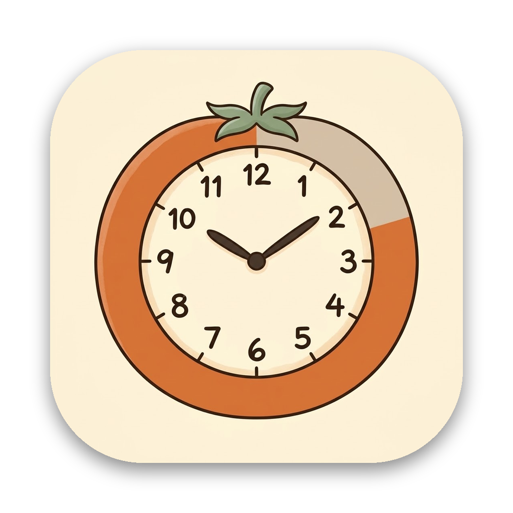
</p>

<h1 align="center">FocusFriends</h1>

<p align="center">
  Un compagno che vive sul desktop del Mac, ti tiene compagnia mentre studi e cresce con il tuo tempo di focus.<br>
  Pomodoro, materie, statistiche e un giardino che cresce con i minuti di studio: una pianta adulta ogni 50.
</p>

<p align="center">
  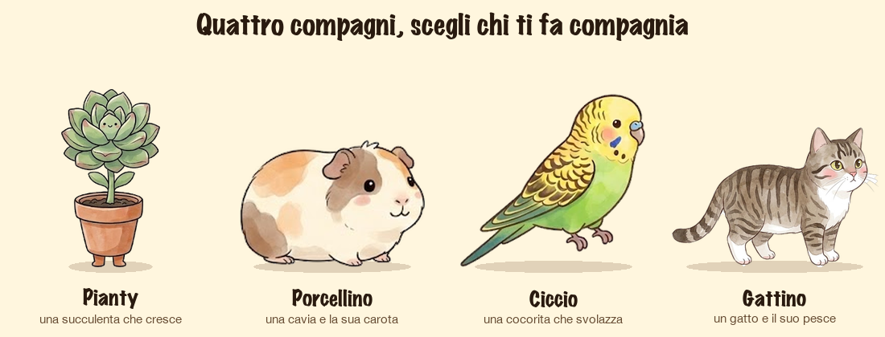
</p>

## I compagni

- **Pianty**, una succulenta con due piedini: cresce mentre lavori (parte da un seme e, man mano che il tempo
  del focus passa, diventa una pianta adulta) e cammina per lo schermo. È il personaggio di partenza.
- **Porcellino**, una cavia che cammina per lo schermo, mangia la carota, fa i pisolini e saltella, con frasi sue.
- **Ciccio**, una cocorita che cammina e ogni tanto sbatte le ali, con frasi sue.

Durante un focus ognuno ha il suo modo di crescere con te: Pianty da seme a pianta, Ciccio da uovo a cocorita
nel suo nido, il Porcellino guarda crescere una carota e, se finisci il focus, la mangia.

<p align="center">
  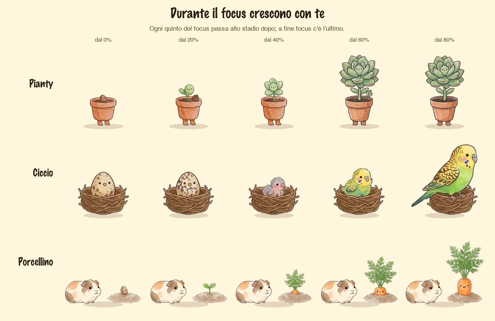
</p>

## Un'occhiata

| | |
|---|---|
| 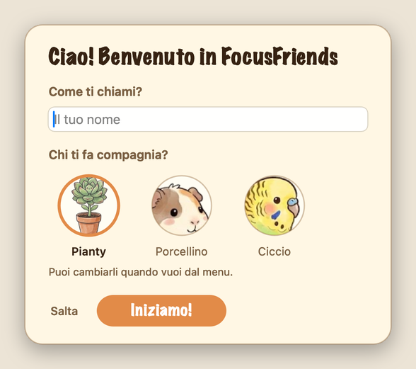 | 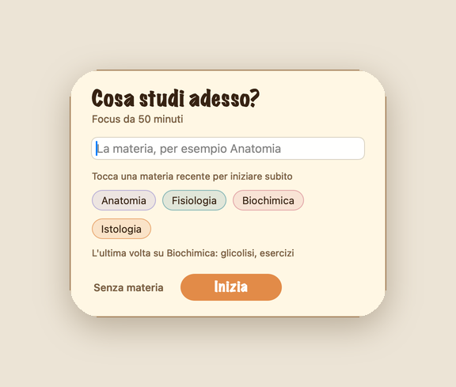 |
| Alla prima apertura: come ti chiami e chi ti fa compagnia. | All'avvio di un focus: la materia, oppure una recente. |

**Com'è andata?**: a fine focus un tocco su una faccia e, se vuoi, una riga su cosa hai fatto. Il tempo da solo
inganna: così a fine settimana vedi anche *quando* rendi meglio.

<p align="center">
  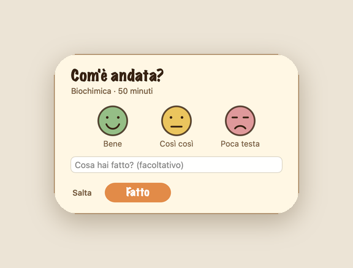
</p>

**Statistiche**: un riepilogo calmo (il totale in grande, le materie in una barra, i giorni di fila e «Com'è andata»)
e, da «Mostra le sessioni», una tendina sotto il riepilogo con la nota e la faccia di ogni focus.

<p align="center">
  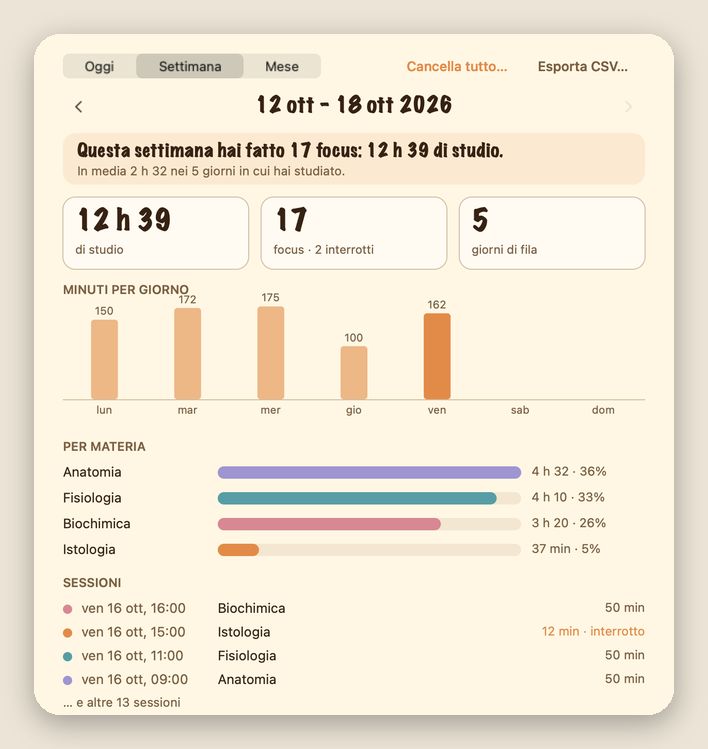
  &nbsp;&nbsp;
  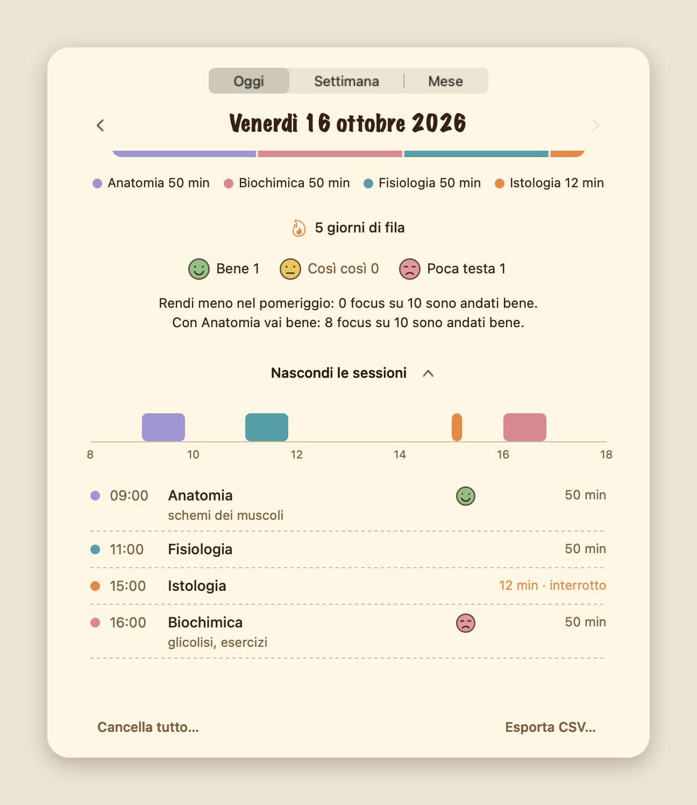
</p>

**Il giardino**: ogni 50 minuti di studio in un giorno è una pianta adulta, e il resto cresce in una piantina più
piccola. Per settimana e per mese.

<p align="center">
  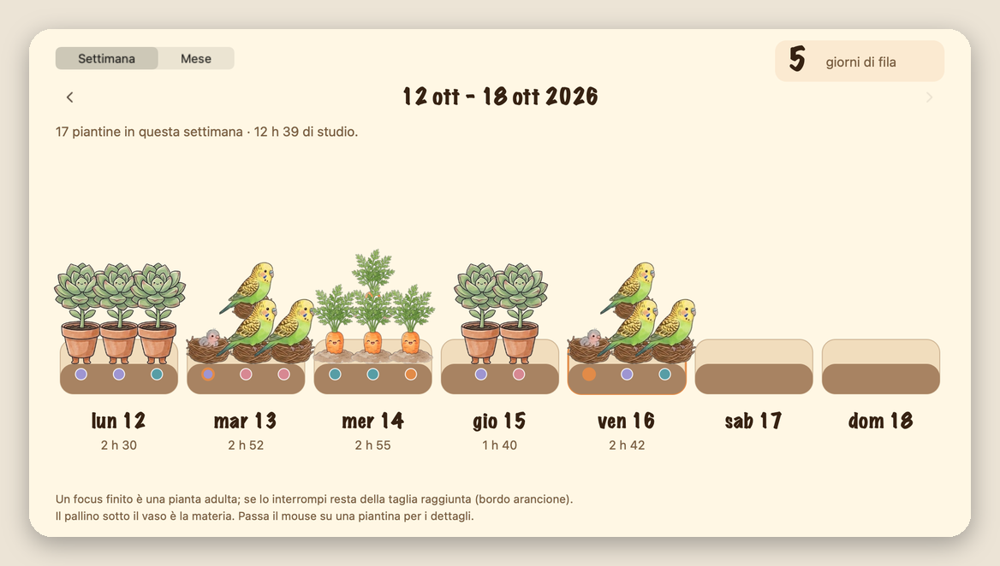
  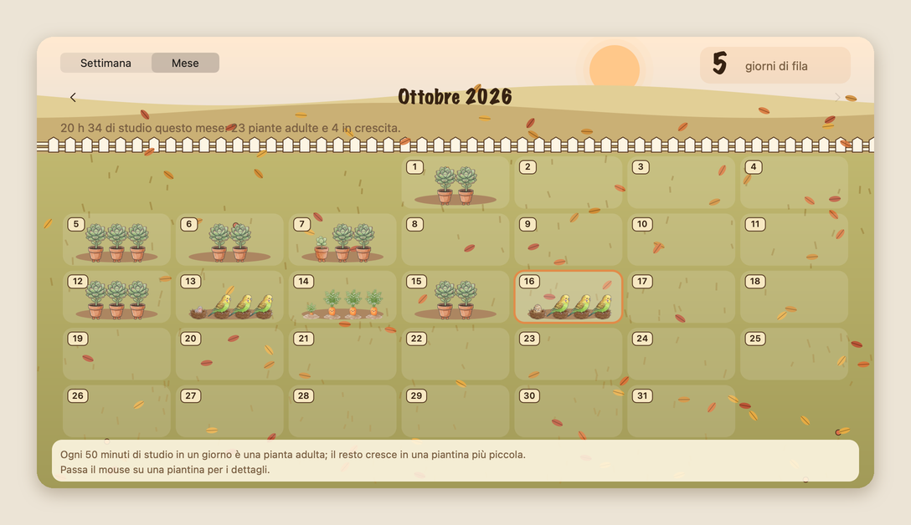
</p>

> Le schermate usano dati di esempio.

## Scaricare e usare

1. Scarica `FocusFriends-0.5.0-macOS.zip` dalla pagina delle [Releases](https://github.com/jaacopocoding/FocusFriends/releases) e decomprimilo.
2. Trascina **FocusFriends** in *Applicazioni* e aprilo (macOS 13 o successivo, Apple Silicon e Intel).
3. L'app non è firmata con un account sviluppatore Apple, quindi la prima volta macOS potrebbe rifiutarla.
   Fai clic destro sull'app → **Apri** → **Apri**, oppure da Terminale:

   ```bash
   xattr -dr com.apple.quarantine /Applications/FocusFriends.app
   ```

Non ha icona nel Dock: la trovi nella barra dei menu e con il tasto destro sul personaggio. I dati (sessioni,
nome) restano sul tuo Mac, in `~/Library/Application Support/FocusFriends/`: nessuna rete, nessun invio.

## Cosa fa

- Compare nell'angolo in basso a destra, sempre sopra le altre finestre e su tutti gli Spaces.
- Ogni 40–110 secondi mostra un fumetto con una frase (la prima dopo 5 secondi dall'avvio). Il fumetto sta sempre
  **sopra tutto ciò che si vede** del personaggio: si alza se cresce, se spalanca le ali o salta, e scende piano quando
  si abbassa; se il personaggio è in alto sullo schermo e sopra non c'è posto, sta di fianco.
- Si può trascinare dove si vuole; fumetto e orologio lo seguono.
- Non ha icona nel Dock: si controlla dalla barra dei menu o con il tasto destro sul personaggio.

## Il menu

Un clic sull'icona nella barra dei menu (o il tasto destro sul personaggio) apre la **scheda del menu**
(`MenuCard.swift`): il compagno sbuca dal bordo, e sotto ci sono i compagni (tocca un nome per cambiarlo), i
focus da 30 e 50 minuti e la pausa, il riepilogo di oggi, *Giardino* e *Statistiche* e le impostazioni più usate.
Toccando il compagno parla; mentre il timer va, un clic sull'icona o sul personaggio apre invece la
[schermata del focus](#la-schermata-del-focus) (o quella della pausa), con *‹ Menu completo* per tornare alla scheda.
Se l'hai aperta dal personaggio, **lo segue** quando cammina o lo trascini (passa dall'altro lato se arriva al bordo dello schermo). Si chiude con un clic fuori o con Esc. Le schermate che si aprono da lì (la scelta della materia, le statistiche, il giardino)
hanno una **freccia indietro** (‹, a sinistra del titolo; ‹ Menu nella barra del titolo delle finestre) che le chiude e
riapre la scheda dov'era, senza ricominciare da capo. *Altri timer…* e *Altre impostazioni…* aprono il menu classico, che si
apre anche con il tasto destro (o ⌥-clic) sull'icona nella barra dei menu:

<p align="center">
  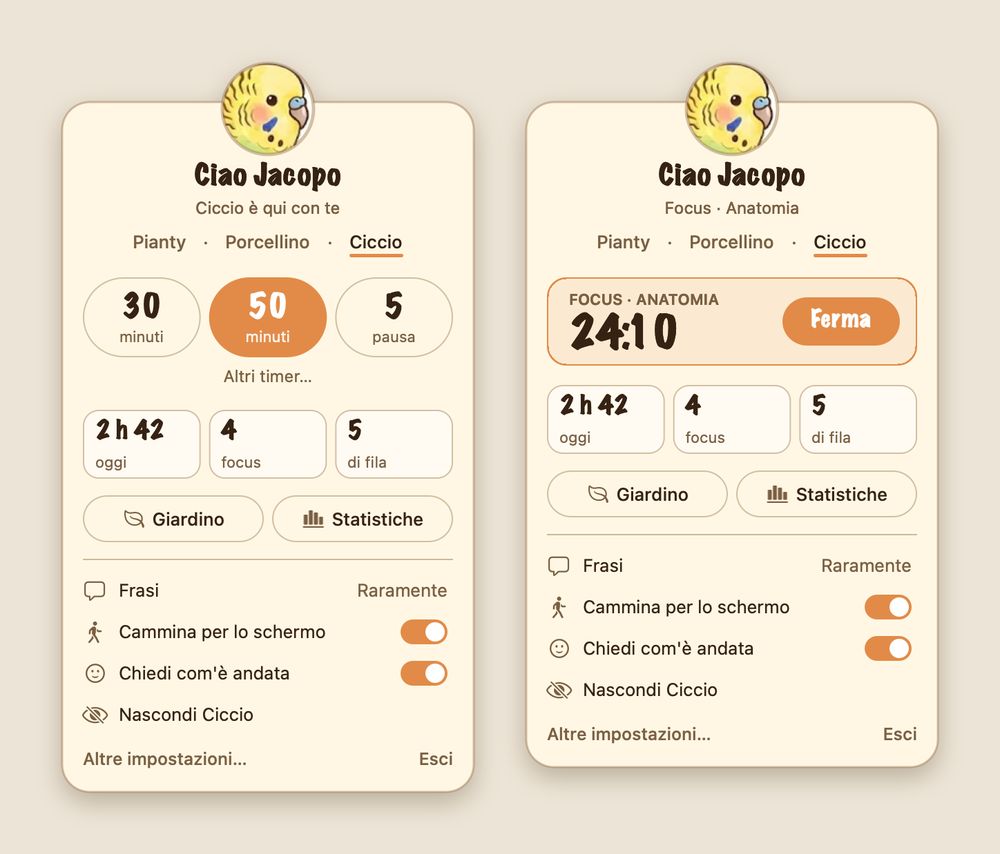
</p>

**Altri timer…** apre «Gira il timer»: un quadrante a forma di pomodoro in cui si trascina il pallino (o si usa la
rotella, un minuto alla volta) per scegliere i minuti, da 5 a 120 per un focus e da 1 a 30 per una pausa. Sotto,
i timer che hai: si toccano per metterli sul quadrante. Un valore nuovo si può *salvare tra i miei timer* (fino a 6
per tipo) e uno tuo si può *rimuovere*. *Avvia* parte con i minuti scelti; la pausa scelta parte da sola dopo ogni focus.

<p align="center">
  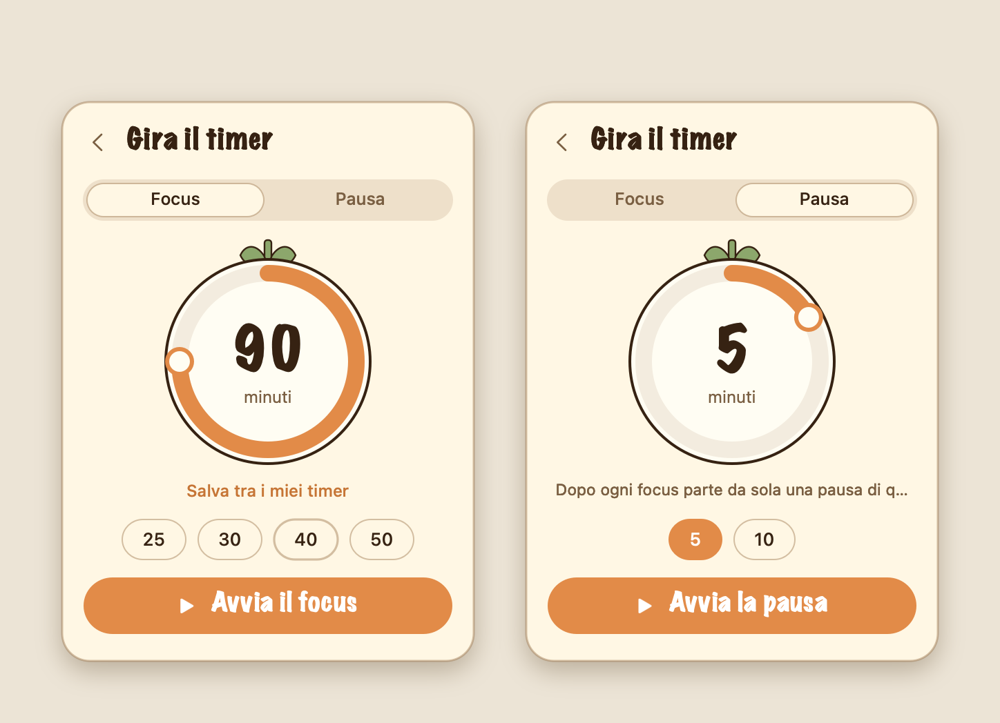
</p>

### Il menu classico

| Voce | Cosa fa |
|---|---|
| Nascondi / Mostra | Lo toglie dallo schermo o lo rimette |
| Fai parlare | Mostra subito una frase |
| Pomofocus ▸ | Timer: *Focus 30/50 min*, *Pausa 5/10 min*, *Personalizza…*, *Ferma timer* |
| Statistiche e riepilogo… | La finestra con il riepilogo di oggi e le statistiche della settimana e del mese |
| Il mio giardino… | Una pianta adulta ogni 50 minuti di studio del giorno, per settimana e per mese (con il tuo nome: «Il giardino di …») |
| Il tuo nome… | Cambia il nome che compare nei titoli |
| Chiedi com'è andata | Se a fine focus compare «Com'è andata?» (spunta = sì) |
| Frequenza delle frasi ▸ | *Spesso* / *Ogni tanto* / *Raramente* / *Mai* |
| Personaggio ▸ | Sceglie il personaggio (la scelta resta alla riapertura) |
| Movimento ▸ | *In movimento* / *Fermo*: per i personaggi che camminano |
| Avvia al login | Si avvia da solo all'accensione del Mac |
| Modifica le frasi… | Apre il file delle frasi del personaggio attivo |
| Esci da FocusFriends | Chiude l'app |

## Pomofocus

Dal menu *Pomofocus* scegli un focus di 30 o 50 minuti: sotto il personaggio compare un mini orologio
digitale con il conto alla rovescia. L'orologio resta visibile per i primi 2 minuti di ogni fase, poi si
ritira; ricompare con un'animazione a tendina quando passi il mouse sul personaggio, e resta sempre
visibile quando mancano 5 minuti o meno. Alla fine del focus suona un avviso e, per 10 secondi, compare accanto al personaggio il pulsante **«+5 minuti»**
(`ExtendPrompt.swift`, con una barretta che si svuota): se lo tocchi il focus continua per altri 5 minuti (e si può
ripetere), altrimenti parte da sola la pausa (5 minuti, oppure l'ultima durata scelta tra *Pausa 5 min* e *Pausa 10 min*, segnata con la spunta).
Alla fine della pausa l'orologio sparisce. Durante il focus il personaggio parla più di rado, per non
distrarti.

**Timer personalizzati**: *Pomofocus ▸ Personalizza…* apre una finestra per aggiungere un focus (1–180 min) o
una pausa (1–60 min). I timer aggiunti (al massimo 6 per tipo, senza doppioni) compaiono nel menu in ordine di
durata insieme a quelli di serie, si ricordano alla riapertura (`CustomTimers.swift`) e si tolgono da *Rimuovi
un timer personalizzato*. Valgono per tutti i personaggi.

## La schermata del focus

Quando un focus è in corso, un clic sul personaggio (o sull'icona) non apre il menu ma la **schermata del focus**:
una pagina di quaderno con la materia, da che ora a che ora dura, il compagno e un grande pomodoro-timer con
l'arco del tempo passato e quello che manca.

<p align="center">
  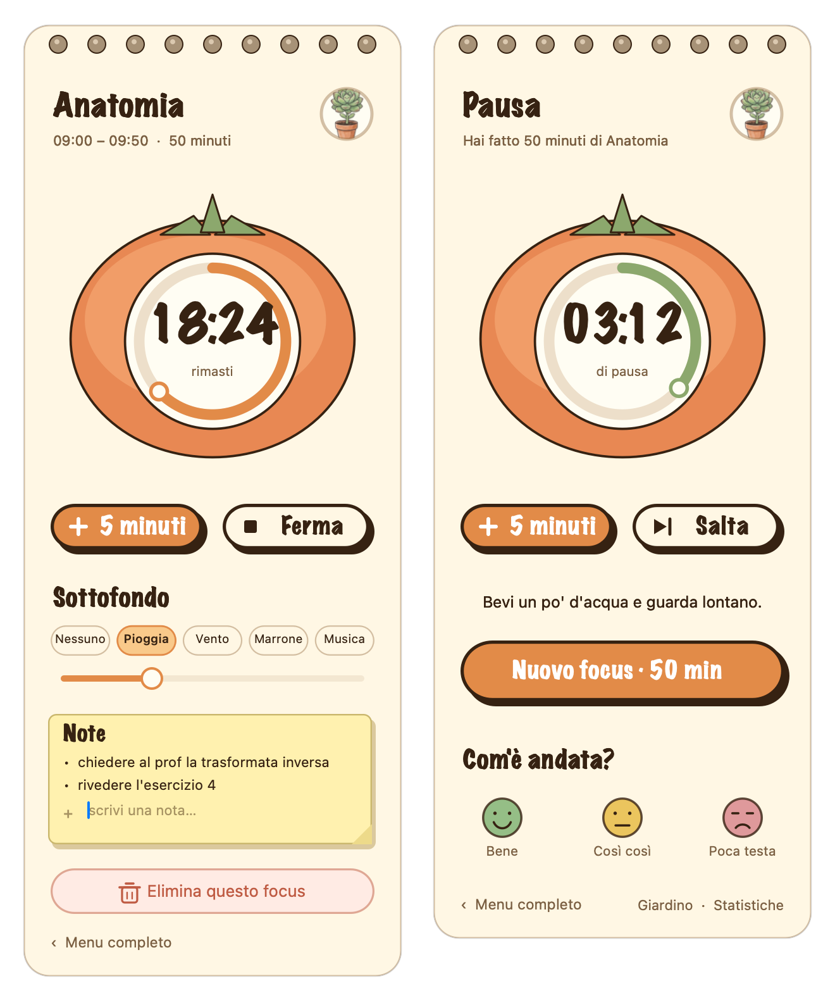
</p>

Sotto il pomodoro:

- **+ 5 minuti** aggiunge cinque minuti al focus (anche prima della fine; si può ripetere); **Ferma** ferma solo il
  conto alla rovescia e resta nella schermata: il pulsante diventa **Riprendi**. Il tempo da fermo non conta nello
  studio (nemmeno se l'app si chiude di colpo: nel file del focus in corso resta scritto quanto è stato fermo), e il
  suono ambiente o la musica si fermano e ripartono con lui. Da fermo compare **Termina e salva**: chiude
  il focus tenendo i minuti fatti (sotto il minuto non viene registrato, come sempre) e le note;
- **Sottofondo**: *Nessuno*, *Pioggia*, *Vento*, *Marrone* o *Musica* (uno alla volta) e il volume. Il suono si
  sente solo durante il focus; la musica sono i brani inclusi, o la tua cartella la prima volta;
- **Note**: un foglietto per appuntare al volo quello che ti passa per la testa mentre studi («chiedere al prof…»).
  Scrivi e premi Invio; le note si salvano subito con il focus (non si perdono se l'app si chiude) e si rivedono
  nelle statistiche, sotto la sessione, e nel CSV (colonna `note_del_focus`). Fino a 40 note da 160 caratteri;
- **Elimina questo focus**: chiede conferma e poi lo butta come se non fosse mai iniziato (niente minuti, niente
  piantina, niente note).

Durante la **pausa** la stessa pagina diventa verde: il tempo di pausa che resta, **+ 5 minuti** e **Salta**,
«Bevi un po' d'acqua e guarda lontano.», **Nuovo focus** (con gli stessi minuti dell'ultimo) e, se non l'hai già
fatto, **Com'è andata?** con le tre facce per l'ultimo focus, più i collegamenti a giardino e statistiche.

## Il tuo nome e il compagno

La prima volta che si apre l'app (anche per chi la usava già) compare la scheda di introduzione
(`IntroCard.swift`): **come ti chiami** e **chi ti fa compagnia** (Pianty, Porcellino o Ciccio). Entrambi sono
facoltativi: *Salta* o Esc lasciano tutto com'è. Il nome personalizza i **titoli**: il giardino diventa
«Il giardino di Marco» e le statistiche «Le statistiche di Marco» (nelle voci di menu e nei titoli delle finestre).
Senza nome restano «Il mio giardino» e «Statistiche e riepilogo». Si cambia in ogni momento da *Il tuo nome…* nel
menu; il compagno da *Personaggio*.

Il nome sta in `profilo.json` (`{"version": 1, "name": …, "introSeen": …}`), accanto a `sessioni.json`, ed
è gestito da `Profile.swift`. **Non è scritto nelle sessioni**: i titoli si compongono al momento, quindi
cambiando il nome cambia ovunque. Viene pulito (spazi in eccesso, al massimo 24 caratteri, maiuscole come
scritte), non esce dall'app (non c'è nell'esportazione CSV) e *Cancella tutto…* lo toglie insieme ai dati
(alla riapertura ricompare la scheda di introduzione).

## Materia e statistiche

Quando si avvia un focus compare la scheda **"Cosa studi adesso?"** (`SubjectPrompt.swift`): si scrive la
materia, oppure si tocca una di quelle usate di recente per partire subito, oppure si sceglie *Senza materia*
(Esc annulla e il focus non parte). Durante il focus la materia compare nell'intestazione del menu
("Focus · Anatomia · 24:10"), e a fine focus il personaggio dice qualcosa come *"Hai studiato Anatomia per
50 minuti. Che bel lavoro!"*.

Ogni focus finisce in un registro (`SessionLog.swift`), un file leggibile in
`~/Library/Application Support/FocusFriends/sessioni.json`: inizio, ora "sull'orologio" a cui è iniziato,
minuti fatti davvero, minuti previsti, completo o interrotto, materia, personaggio. È un JSON con la versione del
formato (`{"version": 2, "sessions": […]}`). Le regole:

- le pause non contano; un focus **interrotto** conta per i minuti che ha fatto davvero, se sono almeno uno;
- una sessione che passa la mezzanotte va al giorno in cui è iniziata, **secondo l'orologio di quando l'hai
  fatta**: se poi cambia il fuso orario o l'ora legale, non cambia giorno (né ora) (`localStart`);
- **le materie si uniscono**: "Anatomia", "anatomia" e "ANATOMIA" (e le versioni con o senza accenti) sono
  la stessa materia; una nuova scrittura prende quella già usata, e nelle sessioni si può cambiare il nome in
  tutte insieme (nella finestra di modifica: «Cambia la materia in tutte le sessioni»);
- se l'app si chiude di colpo durante un focus, la sessione si recupera al prossimo avvio come interrotta
  (un piccolo file `in-corso.json` si aggiorna ogni 30 secondi);
- **copia di sicurezza**: una al giorno, fatta prima della prima modifica, nella cartella `backup/` (le ultime
  7); quando il formato passa a una versione nuova viene tenuta intatta anche la copia di quello vecchio;
- se `sessioni.json` risulta illeggibile viene messo da parte (`sessioni.corrotto-….json`) e si riparte da vuoto;
  se è di una versione **più nuova** di quella dell'app viene letto ma non riscritto, per non perdere nulla;
- **cancellare tutto**: *Cancella tutto…* nella finestra delle statistiche elimina le sessioni, il focus in
  corso e anche le copie di sicurezza (con conferma; prima si può esportare in CSV).

### Com'è andata e cosa hai fatto

A fine focus (se è stato completato) compare **«Com'è andata?»** (`ReflectionCard.swift`): tre facce, *Bene*,
*Così così*, *Poca testa*, e una riga facoltativa «Cosa hai fatto?» (al massimo 80 caratteri). Un tocco su una
faccia salva e chiude; scrivere solo la nota e premere Invio (o *Fatto*) salva la nota; *Salta* o Esc chiudono
senza salvare. La scheda sta accanto al personaggio, **non prende la tastiera** (a fine focus potresti stare
scrivendo altrove: la prende solo se ci clicchi nel campo) e **non blocca niente**: la pausa parte comunque, e se
la ignori sparisce da sola quando la pausa finisce o parte un altro focus. Non compare per i focus interrotti.
Il personaggio risponde al voto (con «Poca testa» dice che capita, non fa i complimenti). Si spegne dal menu con
*Chiedi com'è andata*.

Voto e nota stanno nella sessione (`rating`: `good`, `soso`, `poor`; `note`) e si cambiano toccando la sessione
nelle statistiche. All'avvio di un focus la scheda della materia ricorda l'ultima nota («L'ultima volta su
Anatomia: nervi cranici»). In *Statistiche* c'è la sezione **Com'è andata**: quante volte bene / così così /
poca testa nel periodo e, quando ci sono almeno 8 focus valutati, fino a due frasi su **quando** (fascia della
giornata, giorno della settimana) o **con cosa** (materia) i focus vanno meglio o peggio, sempre con i
conteggi («di mattina: 7 focus su 9 sono andati bene»). Un gruppo deve avere almeno 3 focus e distare almeno 20
punti percentuali dalla media: altrimenti non dice niente, meglio che dire una cosa a caso (`StudyStats.insights`).
Il CSV ha tre colonne in più (`com_e_andata`, `nota`, `note_del_focus`) e i campi di testo che iniziano con `= + - @` hanno un
apice davanti, così un foglio di calcolo non li prende per formule.

Il formato del file passa alla **versione 2** (voto e nota) e poi alla **3** (le note scritte durante il focus):
un file di una versione precedente si legge e si riscrive nel nuovo, tenendo intatta la copia del vecchio in
`backup/sessioni-formato<N>.json`.

*Statistiche e riepilogo…* apre una finestra (`DashboardWindow.swift`) con tre schede: **Oggi**, **Settimana**
(da lunedì) e **Mese**. Con le frecce si va ai periodi precedenti. Il **riepilogo** è fatto per essere calmo:
il totale di studio in grande, quanti focus (completi e interrotti), le barre sottili dei giorni (settimana e mese),
una sola barra a segmenti con le materie e la sua legenda, i giorni di fila e come è andata (con le frasi su
quando rendi meglio, se ci sono dati sufficienti). Sotto, **Mostra le sessioni** apre una **tendina nella stessa
pagina** (il riepilogo resta sopra): per un giorno, una striscia con un blocco colorato per ogni focus sulle ore e
l'elenco con ora, materia, nota, faccia e durata; per una settimana o un mese, le sessioni sotto il loro giorno (con il
totale del giorno). La finestra resta della stessa altezza: la pagina scorre con la rotella. Toccando una sessione si
cambia la materia, la nota, le note del focus e il voto, o la si elimina; *Esporta CSV…* salva tutte le sessioni per un foglio di
calcolo. I dati restano sul Mac: nessun invio da nessuna parte.

Le regole di calcolo hanno le loro prove: `./tests/run.sh` (compila `SessionLog.swift` da solo e controlla
periodi, totali, giorni di fila, recupero, file rovinato, migrazione, materie unite, copie di sicurezza,
fuso orario…).

## Il giardino

*Il mio giardino…* (`GardenWindow.swift`) trasforma il registro in qualcosa da guardare, e si conta **per minuti**:
in ogni giorno si somma il tempo di studio (anche quello dei focus interrotti), e **ogni 50 minuti è una pianta
adulta**. Quello che avanza cresce in una piantina allo stadio di mezzo (`GardenRules` in `SessionLog.swift`):

| Minuti che avanzano nel giorno | La piantina che cresce |
|---|---|
| meno di 1 | niente |
| 1–9 | stadio 1 (il seme) |
| 10–19 | stadio 2 |
| 20–29 | stadio 3 |
| 30–49 | stadio 4 |
| 50 pieni | una pianta adulta (stadio 5), e si ricomincia |

Per esempio 3 h 06 di studio in un giorno sono 186 minuti: **tre piante adulte** e una piantina allo stadio 4 (36
minuti). I minuti riempiono una pianta dopo l'altra nell'ordine in cui li hai studiati, quindi la materia di ogni
pianta (il pallino sotto il vaso) è quella che l'ha fatta crescere di più, e anche il personaggio è quello con cui
l'hai fatta di più. Il giardino è un prato con il cielo, il sole, le colline e una staccionata: la scheda *Settimana* ha un monticello
di terra per giorno, con il suo cartello di legno (giorno e ore), fino a sei piantine, poi "+N"; quella che cresce sta
davanti; *Mese* è lo stesso prato con le caselle del calendario.

Il prato **cambia con le stagioni**, secondo la data del periodo che guardi (primavera da marzo a maggio, estate da
giugno ad agosto, autunno da settembre a novembre, inverno da dicembre a febbraio): in primavera è fresco e pieno di
fiorellini, d'estate più verde, con il cielo azzurro e un sole grande; d'autunno ha le foglie che cadono e i toni
dorati; d'inverno c'è la neve sul prato e sulla staccionata, e cadono i fiocchi. Tornando indietro con le frecce
si rivede la stagione di quel periodo.

<p align="center">
  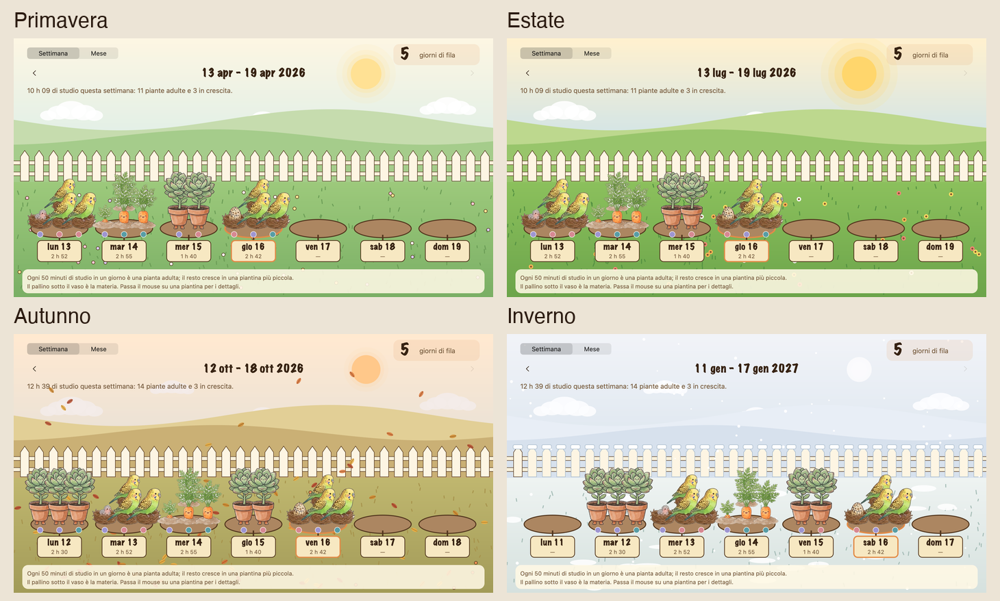
</p> Passando il mouse su una piantina compaiono il
giorno, i minuti e le materie. Si ricava tutto dal registro: compare subito anche per i focus già fatti. A fine
focus il personaggio dice se è nata una pianta adulta o quanti minuti mancano alla prossima.

La crescita **dal vivo** durante un focus (il seme di Pianty che cresce, il nido di Ciccio, la carota del
Porcellino) segue invece quel focus: un quinto del tempo per stadio.

Ogni sessione ricorda **con quale personaggio** è stata fatta (`pet`), e un personaggio può avere la sua
collezione (la piantina usa quella del personaggio con cui hai studiato di più in quei 50 minuti): cinque immagini `garden_<personaggio>_<1..5>.png` in `assets/garden/` (stessa tela di Pianty,
208×341, piedi sulla stessa riga). Chi non le ha usa le piantine di Pianty. Ci sono quella di **Ciccio** (un nido che
va dall'uovo alla cocorita adulta) e quella del **Porcellino** (una carota che cresce dalla terra);
`tools/cutout_garden.py` ritaglia il foglio (`assets/garden/ciccio_nido_original.png`,
`assets/garden/porcellino_carota_original.png`).

## La crescita di Pianty

Pianty ha cinque stadi, dal seme alla pianta adulta. Durante un focus parte dal primo stadio e passa al
successivo ogni quinto del tempo (con un focus da 50 minuti: ai minuti 0, 10, 20, 30 e 40). Durante la
pausa e quando non c'è nessun timer resta allo stadio finale.

## Personaggi che camminano

Pianty, il Porcellino e Ciccio camminano per lo schermo: fanno qualche passo in una direzione
(3–8 secondi, 42 punti al secondo), si fermano 4–10 secondi, poi ripartono, rimbalzando ai bordi.
Stanno fermi mentre parlano o mentre li trascini col mouse. Camminano solo in orizzontale, all'altezza
a cui si trovano. Dal menu *Movimento ▸ Fermo* smettono di camminare e restano dove sono; *In movimento*
li rimette in cammino. Se le immagini guardano a destra (come il porcellino), vengono specchiate quando
vanno a sinistra.

Ciccio, la cocorita, ha 6 fotogrammi di camminata e 6 di battito d'ali. Le ali le sbatte sul posto, ogni tanto e in momenti
casuali, nello stesso modo in cui il porcellino fa il popcorning (stessa probabilità e durata); non mangia e non dorme. Usa le
frasi sue (`assets/frasi_ciccio.txt`).

**Ciccio durante un focus** sta fermo e prende il posto del suo nido (`focusGrowthResources` in `Pet.swift`,
le stesse immagini della sua collezione del giardino): parte dall'uovo e, con il tempo, passa al guscio
incrinato, al pulcino, al piccolo con le piume e infine alla cocorita adulta sul nido; ogni stadio dura un
quinto del focus, come per Pianty. Il fumetto e l'orologio restano nello stesso posto. A fine focus (o se lo
fermi) torna a camminare. Mentre lo sollevi col mouse compare il solito disegno con le mani.

**Il porcellino durante un focus** sta fermo e guarda crescere una carota al suo fianco. La protagonista è la
carota (la matura occupa quasi tutta l'altezza), lui è più piccolo e sta a guardarla; il **gruppo**
porcellino + carota sta al centro, sopra l'orologio, che durante questa fase si abbassa di 12 punti per non
coprire le zampe
(`growth_porcellino_1..5.png`, composte da `tools/compose_porcellino_growth.py` con il suo fotogramma a riposo
rimpicciolito e le carote della sua collezione del giardino). La finestra si allarga attorno ai suoi piedi per fare spazio alla carota (e resta nello schermo),
poi torna com'era. Ogni stadio dura un quinto del focus; **a fine focus, se lo hai completato, mangia la
carota** con la sua animazione, poi riprende a camminare. Se fermi il focus a metà torna a camminare senza
mangiare.

Pianty cammina *e* cresce: per ognuno dei 5 stadi ci sono 7 immagini (fermo + 6 fotogrammi del passo, a 15
al secondo), quindi mentre il focus avanza lo stadio cambia con una dissolvenza e il passo continua senza
interruzioni. I passi non sono disegnati uno per uno: `tools/cutout_pianty.py` parte dal disegno fermo di ogni
stadio e muove solo le gambe, così la pianta è identica in tutti i fotogrammi. Non mangia e non dorme.

Il Porcellino ha un ciclo di passi a 4 fotogrammi, una posa con le orecchie che saltellano mentre
parla, e le sue frasi in `assets/frasi_porcellino.txt`. Ogni tanto, in momenti casuali mentre gira per lo
schermo, si ferma a fare una di queste cose (dopo ogni pausa tra due camminate sceglie a sorte):

| Azione | Probabilità | Durata |
|---|---|---|
| Mangiare una carota | 30% | 6–12 secondi |
| Fare un pisolino, con gli "Zzz" sopra la testa | 15% | 12–30 secondi |
| Il "popcorning" (saltelli di gioia) | 12% | 3–6 secondi |
| Ripartire a camminare | il resto | 3–8 secondi |

Dopo una sosta riparte sempre a camminare. Non dipendono dal Pomofocus. Quando lo trascini col mouse compare un disegno in cui
viene sollevato da due mani, spaventato (con un leggero tremolio); lasciandolo, torna in piedi dove si trova. Vale per il
Porcellino, per Pianty (che lo mostra allo stadio finale, con la pianta adulta) e per Ciccio.

## Compilare dai sorgenti

Serve macOS 13 o successivo e gli strumenti da riga di comando di Xcode (`xcode-select --install`).

```bash
./build.sh                         # crea build/FocusFriends.app (universale: Apple Silicon e Intel)
cp -R build/FocusFriends.app /Applications/
open /Applications/FocusFriends.app
```

Per l'avvio al login è meglio che l'app stia in **Applicazioni**. macOS potrebbe chiedere
l'approvazione in Impostazioni di Sistema → Generali → Elementi login.

## Suono ambiente

Un suono di sottofondo, facoltativo, che accompagna il focus: **pioggia**, **rumore marrone** (basso e avvolgente) o
**vento**. Sono **generati dall'app** in tempo reale da rumore filtrato (`AmbientPlayer.swift`): niente file, niente
licenze, niente rete. Si sceglie dalla scheda del menu (*Suono ambiente*, con il cursore del volume sotto) o dal menu
classico (*Suono ambiente ▸*); cambiando suono o volume se ne sente un'anteprima di qualche secondo. Parte con una
dissolvenza di 2 secondi quando comincia il focus (e continua durante i secondi del «+5 minuti») e si spegne con la
stessa dissolvenza quando il focus finisce: in pausa è silenzio. Il volume di partenza è basso (25%). La scelta si
ricorda alla riapertura, e la scelta del suono e del volume sta in `AmbientSound.swift` (con le prove).

## Musica

La **musica** del focus, facoltativa, funziona come il suono ambiente: parte con il focus (con una dissolvenza di 2
secondi), si ferma a fine focus e in pausa è silenzio, in ordine casuale e senza ripetere subito lo stesso brano.
Si sceglie dalla scheda del menu (riga *Musica*, con il suo cursore del volume) o dal menu classico (*Musica ▸*):

- **La mia cartella**: l'app suona i file audio (mp3, m4a, aac, wav, aiff, flac) di una cartella che scegli tu, anche
  nelle sottocartelle. Non viene copiato né inviato niente: i file restano dove sono. La prima volta chiede la
  cartella; si cambia da *Musica ▸ Scegli la cartella…*.
- **Brani inclusi**: cinque brani strumentali e calmi (*Boredom*, *Love*, *Night Driving*, *Old Age*, *Opinions*) di
  **HoliznaCC0**, pubblicati in pubblico dominio con la licenza **CC0**. Autore, fonti e licenza sono nel file
  [`CREDITS.md`](CREDITS.md). Lo zip dell'app passa da circa 8 a circa 21 MB.

Il volume di partenza è basso (30%). **Un solo sottofondo alla volta**: accendendo la musica si spegne il suono
ambiente (pioggia, vento…) e viceversa. Il codice è in `MusicPlayer.swift` (riproduzione) e `MusicLibrary.swift` (quali file e in che ordine, con le prove).

## Frasi

Le frasi di partenza sono in `assets/frasi_pianty.txt` (Pianty), `assets/frasi_porcellino.txt`
(Porcellino) e `assets/frasi_ciccio.txt` (Ciccio), una per riga
(le righe che iniziano con `#` sono ignorate). Per usare le tue senza ricompilare, scegli *Modifica le
frasi…* dal menu: crea e apre `~/Library/Application Support/FocusFriends/frasi_pianty.txt` (o quello del porcellino
o di Ciccio), che ha la precedenza sul file incluso nell'app. Le modifiche valgono dalla frase successiva.
Se esiste ancora la vecchia cartella `Application Support/Bonsy` (dai tempi in cui l'app si chiamava così), viene
letta come seconda scelta. Anche le preferenze (personaggio, frequenza, timer personalizzati) vengono copiate
dalla vecchia app al primo avvio (`Migration.swift`).

Le frasi escono **a mazzo** (`PhraseDeck.swift`): tutte, in ordine casuale, prima che una si ripeta; la prima
del giro successivo non è mai uguale all'ultima uscita. La **frequenza** si sceglie dal menu (*Frequenza delle
frasi*, `Chattiness.swift`): "Ogni tanto" è il valore di partenza (40–110 secondi, durante un focus 4–8
minuti); "Mai" tace subito, anche il fumetto che c'è. Restano sempre i messaggi del timer e *Fai parlare*.

## L'intestazione del menu classico

In cima c'è una scheda color carta (`MenuHeader.swift`) con la testa del personaggio in un avatar circolare, il
suo nome nel carattere del fumetto e cosa sta facendo ("Qui con te", "Focus · 24:10", "Pausa · 03:12",
"Nascosto"). Le voci hanno un'icona di sistema (SF Symbols) e mostrano lo stato accanto al titolo
("Frequenza delle frasi · Ogni tanto", "Pomofocus · 24:10", "Personaggio · Porcellino").

## Struttura

```
Sources/FocusFriends/
  main.swift            avvio dell'app
  AppDelegate.swift     crea finestra, fumetti, timer e menu
  Pet.swift             i personaggi: immagini, frasi, misure, come camminano
  PetWindow.swift       finestra trasparente con il personaggio e i suoi stadi
  Speaker.swift         tempi e comparsa dei fumetti
  Walker.swift          camminata dei personaggi che camminano
  SpeechBubble.swift    fumetto: immagine scalata sul testo
  Quotes.swift          caricamento delle frasi
  Pomodoro.swift        logica del timer focus/pausa e crescita
  TimerBubble.swift     orologio digitale sotto il personaggio
  MenuController.swift  icona nella barra, menu classico, avvio al login
  MenuCard.swift        la scheda del menu (clic sull'icona o tasto destro sul personaggio) e le schermate del focus e della pausa
  FocusScreenViews.swift  il pomodoro-timer, il foglietto delle note e i pulsanti della schermata del focus
  AmbientSound.swift    i suoni ambiente e le scelte (solo Foundation, con prove)
  AmbientPlayer.swift   il motore audio: rumore filtrato in tempo reale
  MusicLibrary.swift    la musica: quali file e in che ordine (solo Foundation, con prove)
  MusicPlayer.swift     la riproduzione dei brani del focus
  SessionLog.swift      registro delle sessioni di studio e statistiche (solo Foundation, con prove)
  Profile.swift         il nome (solo Foundation, con prove) e i titoli personalizzati
  IntroCard.swift       la scheda di introduzione: nome e compagno
  SubjectPrompt.swift   la scheda "Cosa studi adesso?"
  ReflectionCard.swift  la scheda "Com'è andata?" a fine focus
  DashboardWindow.swift la finestra delle statistiche (Oggi / Settimana / Mese)
  GardenWindow.swift    il giardino: le piantine di ogni giorno (50 minuti = una adulta), per settimana e per mese
  PaperUI.swift         elementi grafici in comune delle schede (carta, pulsanti, colori delle materie)
assets/
  pianty/original.png   immagine di partenza di Pianty senza piedini (5 stadi, non più usata dal ritaglio)
  pianty/sheets/stage1..5.png   le tavole di Pianty con i piedini (un foglio per stadio; si usa il primo fotogramma)
  pianty/stage{1..5}_{1..7}.png   i 35 fotogrammi (_1 fermo, _2.._7 passo), generati da tools/cutout_pianty.py
  pianty/picked_original.png, picked.png   Pianty sollevata dalle mani (tools/cutout_picked.py)
  porcellino/original.png     immagine di partenza del porcellino (5 fotogrammi)
  porcellino/eat_original.png, sleep_original.png, jump_original.png   i fogli della carota, del sonno e del popcorning
  porcellino/frame*.png       fotogrammi ritagliati e allineati (1-5 cammino, 6-10 mangia, 11-14 dorme, 15-19 popcorning), da tools/cutout_porcellino.py
  porcellino/picked_original.png, picked.png   il porcellino sollevato (tools/cutout_picked.py)
  ciccio/walk_original.png, flap_original.png   le tavole della cocorita (camminata e ali, 6 fotogrammi ciascuna)
  ciccio/picked_original.png, picked.png   Ciccio sollevato dalle mani (tools/cutout_picked.py ... 252: maniche quasi bianche)
  ciccio/frame1..13.png   fermo (ali chiuse, zampe a terra), 6 di camminata, 6 di ali (tools/cutout_ciccio.py)
  bubble_original.png, bubble.png   fumetto e ritaglio (tools/cutout_bubble.py)
  frasi_pianty.txt, frasi_porcellino.txt, frasi_ciccio.txt   frasi incluse nell'app
  logo_original.png     il logo: un pomodoro-timer con l'anello che mostra il tempo
  AppIcon.png, AppIcon.icns   icona dell'app, generata da tools/make_icon.py (il logo nella forma delle icone di macOS);
                        la stessa immagine è in docs/images/logo.png, quella che mostra il README
tools/                  script per ritagli e icona (Python con Pillow e numpy)
build.sh                compila e crea build/FocusFriends.app
tests/                  prove del registro e delle statistiche (./tests/run.sh)
```

## Aggiungere o cambiare un personaggio

Un personaggio è una riga in `Pet.swift` (con `pickedResource` può avere un disegno diverso mentre lo si trascina): immagini (una per stadio, tutte sullo stesso formato e
allineate sulla linea di terra), file delle frasi, dimensione della finestra. Un solo stadio = personaggio
fisso, più stadi = cresce con il timer; con `walks: true` le immagini sono pose e il personaggio
cammina; con `framesPerStage` ogni stadio ha il suo gruppo di pose (cresce e cammina, come Pianty); `stepInterval` regola la velocità del passo. Per ritagliare un'immagine su sfondo bianco si può partire da
`tools/cutout_picked.py` (un solo disegno) o `tools/cutout_ciccio.py` (tavole con più fotogrammi).
