

  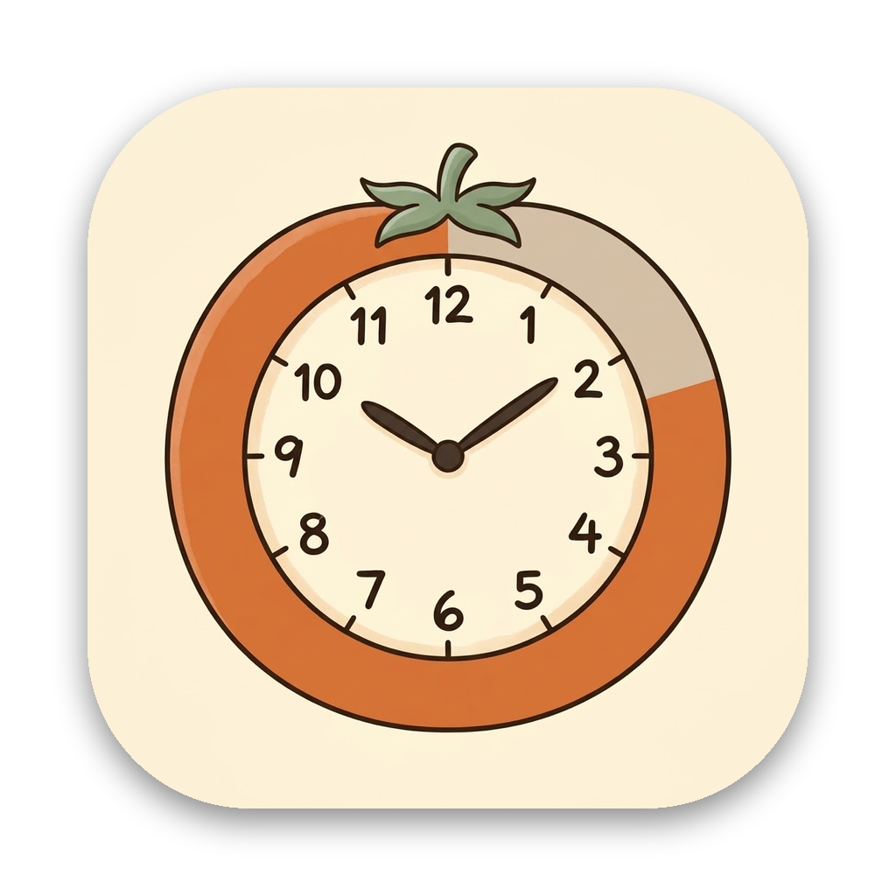

<h1 align="center">FocusFriends</h1>

  <b>Il compagno che ti accompagna nel focus.</b> 
  Un animaletto che vive nel tuo schermo: cammina, dice parole gentili e ti aiuta a tenere traccia del tuo studio sul desktop.  

  Per Mac e Windows · gratis · senza account · i tuoi dati restano sul tuo computer

  <a href="https://github.com/jaacopocoding/FocusFriends/releases"><b>Scarica</b></a> &nbsp;·&nbsp; <a href="docs/GUIDA.md">Guida completa</a>

  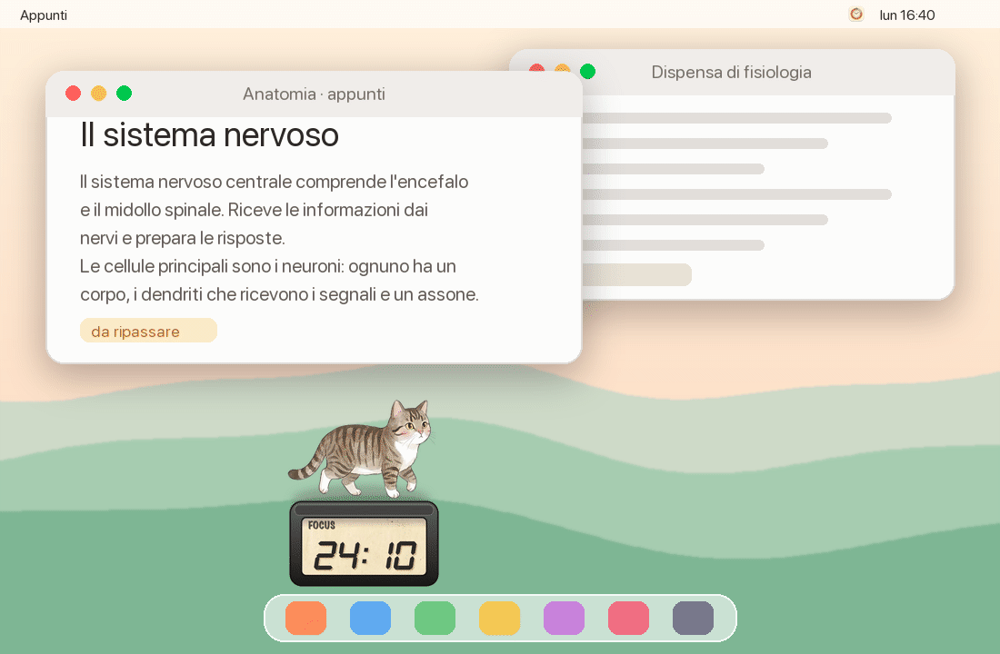

 

## Scegli chi ti fa compagnia

  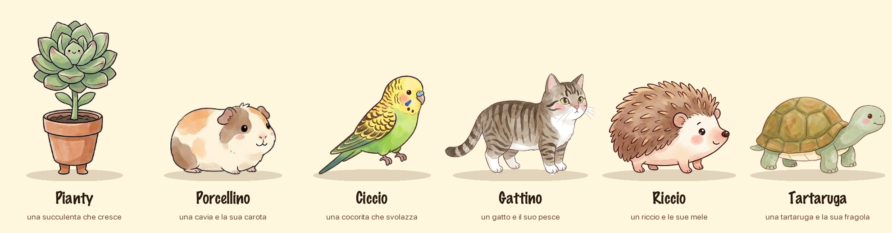

Sei amici, ognuno con il suo carattere e le sue frasi. Il primo lo scegli tu, gli altri si sbloccano studiando.

## Il timer, in un tocco

  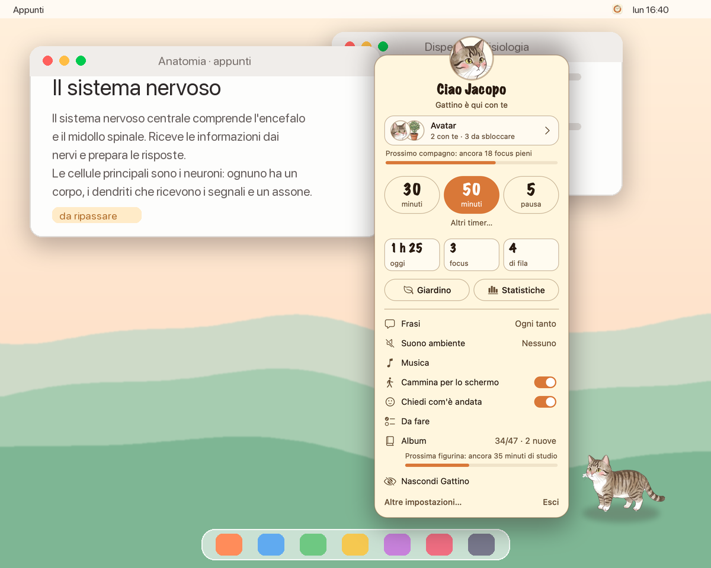

Attraverso il menu puoi iniziare un pomofocus con un timer che scegli tu, oppure puoi accedere alle diverse funzionalità dell'app.

  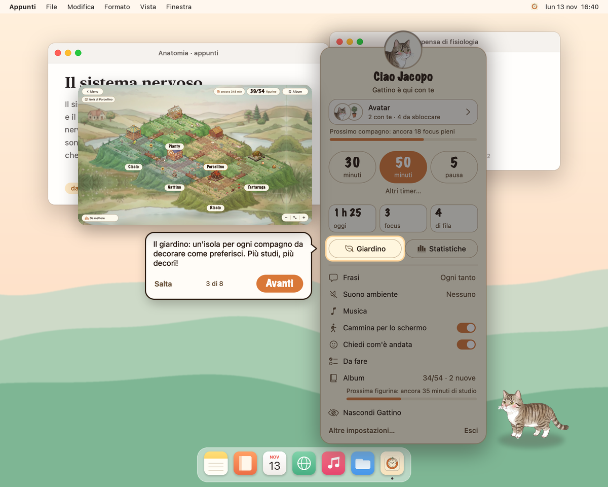

Alla prima apertura il compagno ti chiama e ti spiegherà come funziona l'app.

**Un giardino da riempire.**

Studiando trovi figurine: le metti sulle tue isole, dove vuoi, quante volte vuoi. E un album da completare.

<table align="center">
  <tr>
    <td>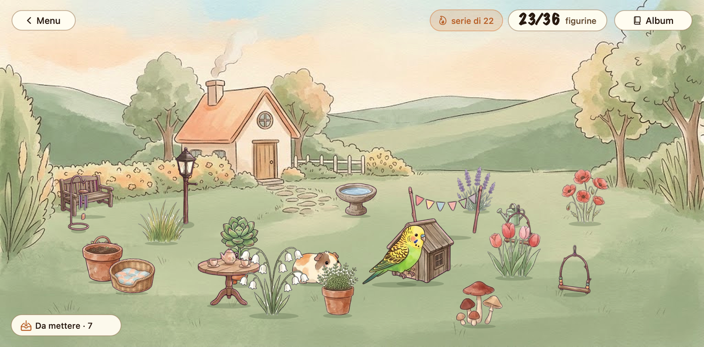</td>
    <td>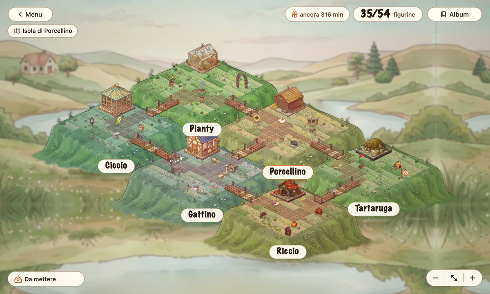</td>
  </tr>
  <tr>
    <td>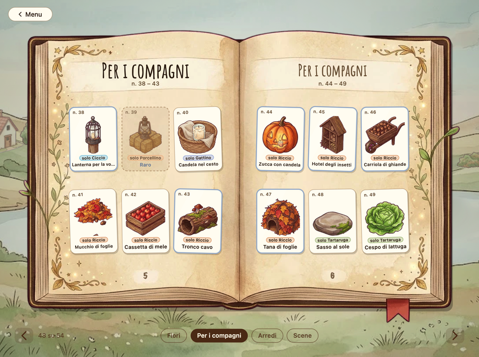</td>
    <td>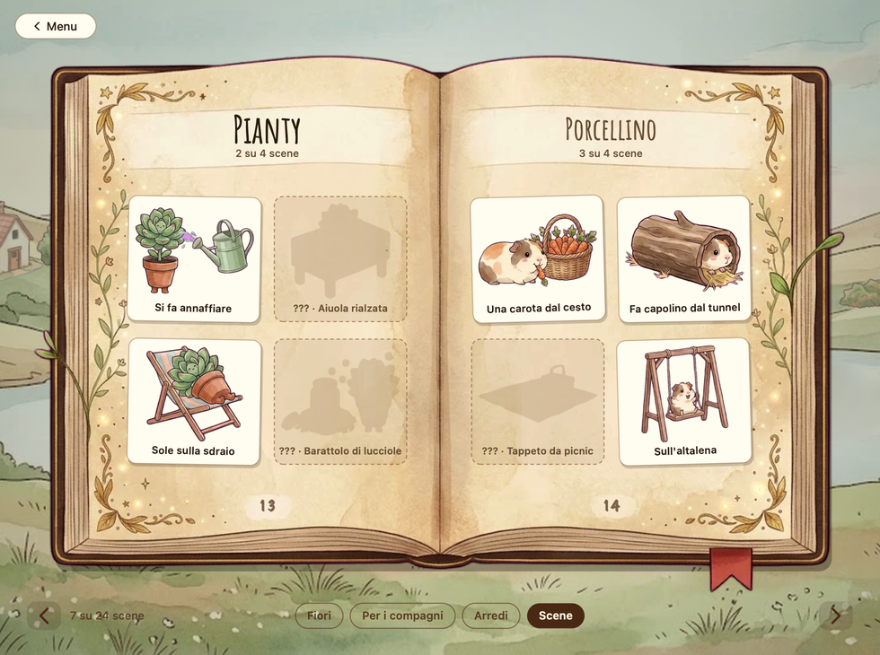</td>
  </tr>
</table>

**Sai dove va il tuo tempo.**

L'andamento giorno per giorno, le ore di ogni materia, l'anno intero a colpo d'occhio, e una lista di cose da fare con la scadenza.

<table align="center">
  <tr>
    <td>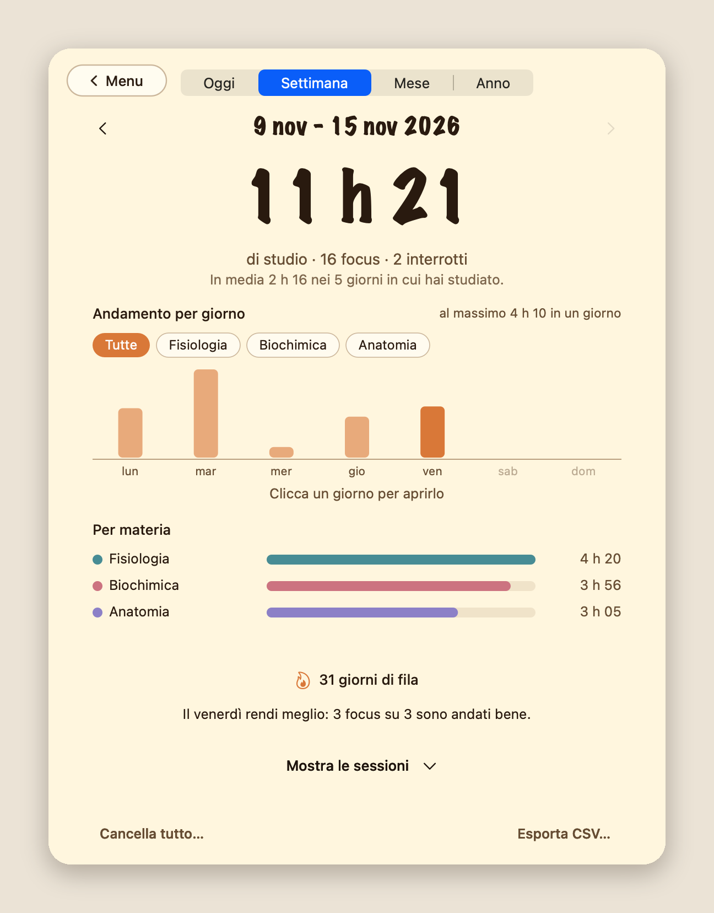</td>
    <td>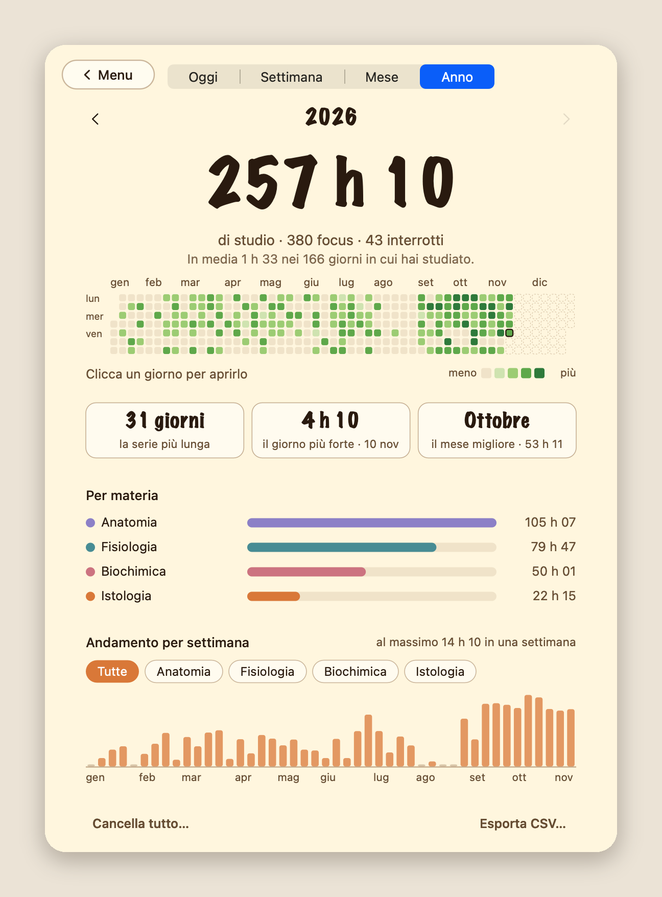</td>
  </tr>
  <tr>
    <td colspan="2" align="center">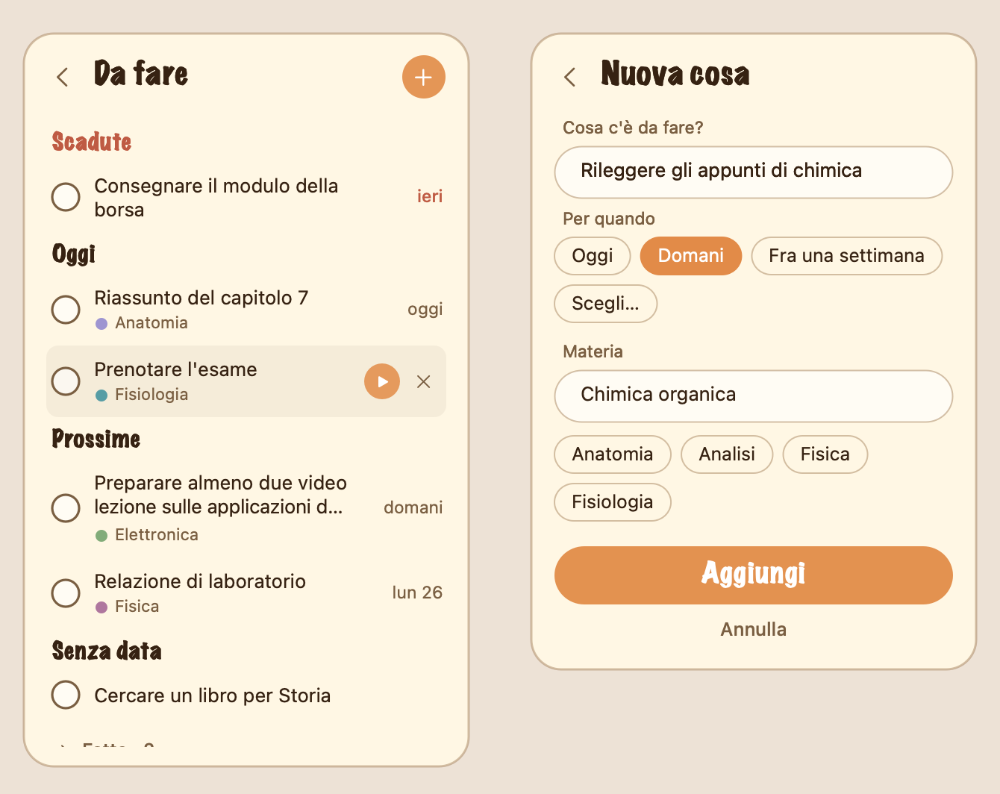</td>
  </tr>
</table>

 

## Scarica

**Mac** (macOS 13 o successivo) · dalle [Releases](https://github.com/jaacopocoding/FocusFriends/releases) scarica lo zip, trascina l'app in *Applicazioni* e aprila. La prima volta: clic destro → **Apri**.

**Windows** (10 e 11) · dalle [Releases](https://github.com/jaacopocoding/FocusFriends/releases) scarica l'installer. La prima volta: *Ulteriori informazioni* → *Esegui comunque*. Dalla 1.3 c'è anche il giardino, con l'album.

L'app non è firmata con un account sviluppatore, per questo il sistema chiede conferma. Tutto il resto è nella [guida](docs/GUIDA.md).

 

---

  <a href="docs/GUIDA.md">Guida</a> ·
  <a href="ARCHITECTURE.md">Architettura</a> ·
  <a href="FORMATI.md">Formati dei dati</a> ·
  <a href="CREDITS.md">Crediti</a> ·
  <a href="LICENSE">Licenza MIT</a>

